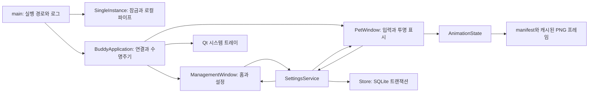

# 아키텍처

## 현재 구현

- `core/`: 브랜드/버전, 사용자 데이터와 번들 리소스 경로, 설정 값 검증, 독립적인 화면 좌표 계산.
- `database/`: SQLite 스키마 버전과 저장/로드. 현재 `app_settings` 테이블만 생성한다.
- `services/`: 설정 저장 후 변경 신호 발생, 프로세스 단일 실행과 기존 창 활성화.
- `characters/`: 상태 전환과 프레임 순서·FPS·루프·종료 처리, 에셋 로드와 대체 이미지.
- `ui/`: 캐릭터 입력, 말풍선, 통합 관리창, 테마. SQL과 미래 타이머 계산을 위젯에 넣지 않는다.
- `app.py`: UI·서비스·트레이·모니터 신호 연결. `main.py`: 경로·예외 처리·앱 이벤트 루프.
- `tools/`: 기본 에셋 재생성, 자체 위젯 미리보기, Windows Qt 수명주기 검증, 버전 리소스.

## 창과 입력

캐릭터는 Qt Tool + FramelessWindowHint + WA_TranslucentBackground를 사용한다. [Qt 공식 QWidget 문서](https://doc.qt.io/qtforpython-6/PySide6/QtWidgets/QWidget.html)의 투명 창·마스크·마우스 이벤트 API를 기준으로 구현했다.

이미지는 앱 시작 때 한 번 읽고 크기 변경 때만 스케일링한다. 현재 상태 프레임 실루엣의 합집합 마스크를 캐시해 빈 모서리를 제외하며, 상태가 달라지면 마스크를 교체한다. 프레임 간 미세한 모양 차이 영역까지 픽셀 단위 클릭 통과를 보장하지는 않는다. 실제 Windows 합성/클릭 통과는 수동 검증 대상이다.

단일 클릭은 `QApplication.doubleClickInterval()` 동안 지연한다. 더블클릭은 대기 중 단일 클릭을 취소한다. 드래그는 `startDragDistance()`를 넘으면 시작하고 클릭을 취소한다. 이동 완료 시에만 저장한다.

관리창은 앱 수명 동안 하나만 유지한다. 닫기는 hide, 프로그램 종료는 QApplication.quit이다. 마지막 창이 닫혀도 자동 종료하지 않는다. 트레이가 없는 환경에서는 숨김 요청 시 관리창을 보여준다.

## 애니메이션

`manifest.json`이 상태별 상대 경로, FPS, loop를 정의한다. idle은 3 FPS, happy는 8 FPS이며 끝나면 idle로 돌아온다. 이미지 누락은 남은 프레임을 사용하고 idle이 없으면 코드로 그린 대체 이미지를 표시한다. 에셋 경로가 루트 밖으로 나가는 경우 로드하지 않는다.

QTimer만 사용하며 busy loop는 없다. 숨김·움직임 줄이기·정지 이미지 상태에서는 애니메이션 타이머를 중단한다. 현재 감정 판단은 없고 이벤트에 따른 idle/happy 전환만 제공한다.

## 저장과 실행 안전성

- `%LOCALAPPDATA%/DesktopBuddy/buddy.db`, 스키마 버전 1.
- `app_settings(setting_key TEXT PRIMARY KEY, setting_value TEXT NOT NULL)`.
- 값은 JSON 직렬화 후 타입·범위 검증. 알 수 없는 키는 현재 설정에 반영하지 않는다.
- 저장은 트랜잭션 + UPSERT. 성공한 뒤에만 서비스 상태와 UI를 갱신한다.
- 기존 버전에서 스키마를 올리기 전에 SQLite backup API로 타임스탬프 백업을 만든다.
- 손상 DB나 현재보다 높은 버전은 거부한다. 원본을 삭제하거나 초기화하지 않는다.
- 현재는 모든 DB 작업이 짧은 메인 스레드 설정 작업이다. 미래 네트워크와 큰 ICS 처리는 작업 스레드에서 수행하고 각 스레드는 자체 DB 연결을 사용한다.
- `QLockFile`과 사용자별 `QLocalServer`를 함께 사용한다. 데이터 경로 해시로 실행 채널을 분리하고 실제 사용자 데이터와 QA 실행이 충돌하지 않게 한다.
- 두 번째 프로세스는 `show` 요청을 보내고 기존 프로세스의 ACK를 기다린다. 프로세스 간 통신은 로컬 named pipe이며 외부 네트워크 요청이 아니다.
- 종료 시 위치 저장, 애니메이션 중단, 말풍선·관리창 숨김, 트레이 제거, 잠금·DB 해제를 수행한다.
- 앱 표시 이름은 metadata.py에서 관리한다. 기존 데이터 경로는 브랜드 변경과 별도로 유지한다.

## 미래 단계의 설계 방향 — 미구현

- Task와 CalendarEvent는 구분한다. RepeatRule/RRULE과 RecurrenceException으로 발생 일정과 단일 예외를 계산한다.
- FocusTimerService를 UI와 독립시켜 관리창·채팅이 같은 명령을 호출한다. monotonic 누적, 일시정지 분리, 절전/강제 종료 복구는 보수적으로 처리한다.
- FocusSession 원본으로 통계를 계산한다. 자정과 시간대 경계에서 실제 집중 구간을 분리한다.
- EmotionService가 유효 세션·휴식일·우선순위를 계산해 AnimationState로 이벤트를 전달한다.
- 오프라인 명령과 AI는 허용된 서비스 호출만 사용한다. LLM이 SQL·파일·셸을 실행하는 구조는 만들지 않는다.
- AI 키는 Windows Credential Manager에 저장한다. 일정/학습 기록 전송은 사용자가 선택하고 추가/수정/삭제를 확인한다. 다중 사용자 서비스로 확장할 때는 별도 서버 인증 설계가 필요하다.
- CalendarProvider는 Local/ICS/공식 검증된 외부 제공자를 구분한다. Planit 공식 지원은 아직 조사하지 않았으므로 연결 구현이 없다.
- Task, CalendarEvent, RepeatRule, RecurrenceException, FocusSession, Notification, ChatMessage, SyncMetadata는 해당 단계에서 필요한 마이그레이션과 함께 추가한다.

이 설계는 후속 구현의 경계이며 작동하는 기능 목록이 아니다.
