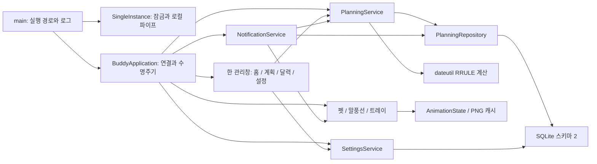

# 아키텍처 — 0.2.0

## 연결 구조

- `core/`: 브랜드/버전, 사용자 경로·번들 경로, 설정 검증, 독립 화면 좌표 계산.
- `models/planning.py`: Task, CalendarEvent, Category, Occurrence, Reminder. UI와 SQL을 포함하지 않는다.
- `database/store.py`, `migrations.py`: 설정과 스키마 이전. `planning_repository.py`: 계획·분류·예외·완료·알림 처리 이력의 SQL.
- `calendar/recurrence.py`: 범위가 제한된 반복 계산·분할·남은 횟수. `layout.py`: 시간 겹침 그룹과 표시 열 계산.
- `services/planning_service.py`: 검증, 트랜잭션, 발생 항목과 날짜별 완료, 범위 수정/삭제, 알림 후보.
- `services/notification_service.py`: 30초 간격 알림 확인, 중복 처리 이력, 시간대 제한과 일시중지. 외부 네트워크 요청은 없다.
- `ui/`: TodayPage, CalendarPage, TimelineView, 편집/범위/분류 대화상자. 한 관리창 안에서 데이터를 공유한다. SQL을 직접 호출하지 않는다.
- `tools/`: 자체 에셋, QA 전용 예시 화면, Windows Qt 수명주기 검사, Windows 버전 리소스.

## 저장소

`%LOCALAPPDATA%/DesktopBuddy/buddy.db`, `PRAGMA user_version = 2`.

| 테이블 | 역할 |
|---|---|
| app_settings | 타입·범위를 검증한 설정 JSON 값 |
| categories | 분류 이름·색상. 삭제 시 항목 FK는 NULL |
| tasks | 예정 날짜·선택 시간·마감·우선순위·반복 규칙·일회성 완료 |
| calendar_events | 시작·종료·종일 여부·반복 규칙·사전 알림 |
| recurrence_exceptions | task/event 중 하나만 소유, 원래 발생 날짜, 취소 또는 전체 개별 수정 스냅샷 |
| task_completions | 반복 할 일의 ID + 원래 날짜별 완료/취소 |
| notification_log | 알림 키별 처리 시각과 shown/suppressed 상태 |

일정과 할 일은 별도 테이블이다. 현재 버전은 공부 기록을 저장하지 않는다. 항목과 분류 ID는 AUTOINCREMENT로 재사용하지 않아 이전 알림 이력·개별 스냅샷이 새 항목에 잘못 적용되는 것을 막는다.

SQLite foreign_keys와 트랜잭션을 사용한다. 이전 DB를 열 때 backup API로 원본 백업을 만든 뒤 명시적 BEGIN IMMEDIATE에서 DDL과 버전을 함께 이전한다. 실패하면 전체 롤백하고 DB를 초기화하지 않는다. 저장 성공 후에만 changed 신호를 발생시켜 화면을 갱신한다.

## 반복과 시간

RRULE은 [python-dateutil 공식 문서](https://dateutil.readthedocs.io/en/stable/rrule.html)의 계산기를 사용한다. UI에서 매일, 매주/요일, 매월 같은 날짜, 매년 같은 날짜, 간격·COUNT 또는 UNTIL을 설정한다. 시간보다 짧은 고빈도 반복은 허용하지 않는다.

실제 발생 항목을 여러 줄 복제 저장하지 않는다. 범위를 1~366일로 제한해 계산하며 무횟수 규칙은 간격 위상을 유지한 가까운 시작점으로 이동한다. 월말·윤년의 없는 날짜를 건너뛴다. ZoneInfo 시간대의 존재하지 않는 DST 시각도 제외하며 유효 COUNT에 포함하지 않는다. Windows용 tzdata를 번들에 포함한다.

DB의 이벤트/마감 시각은 UTC 문자열로 보관하고 각 레코드의 IANA 시간대로 반복한다. 화면은 현재 한국(서울) 시간이다. 일정을 자르는 날짜 구간은 [시작, 종료)이며 종일 편집창의 사용자 종료일은 포함해 해석한다. 자정을 넘는 일정은 양쪽 날짜에 나타난다.

발생 키는 **원래 지역 날짜**이다. 한 항목을 다른 달로 옮겨도 같은 키로 예외와 완료 상태를 유지한다. 이동한 예외는 원래 날짜가 조회 범위 밖이어도 실제 날짜로 조회한다.

이후 수정은 이전 규칙에 UNTIL을 붙이고 이후 구간을 새 원본으로 나눈다. 남은 COUNT를 계산하고 이후 개별 예외·완료·알림 처리 이력을 옮긴다. 전체 과정은 한 트랜잭션이다. 반복 중단 시 개별 수정과 이미 완료한 날짜는 일회성 항목으로 보존한다. 변경하지 않은 미래 반복은 규칙 변경에 따른 새 발생 결과를 따른다.

## 화면과 입력

기존 투명 펫은 [Qt QWidget 공식 API](https://doc.qt.io/qtforpython-6/PySide6/QtWidgets/QWidget.html)의 Tool/Frameless/TranslucentBackground와 캐시한 상태별 실루엣 마스크를 사용한다. 단일 클릭은 OS 더블클릭 판정 시간 뒤 실행하며 더블클릭/드래그는 대기를 취소한다. 숨김/움직임 줄이기에서 프레임 타이머를 멈춘다.

달력은 실제 6×7 날짜 칸과 선택 날짜 목록을 제공한다. 주/일 보기는 [Qt Graphics View](https://doc.qt.io/qtforpython-6/overviews/qtwidgets-graphicsview.html) 기반이다. 종일 영역을 고정하고 시간대만 스크롤한다. 겹침 연결 그룹을 여러 열로 배치하고 작은 블록의 글자는 영역 안으로 잘라 겹쳐 그리지 않는다. 실제 제목/시각은 툴팁과 선택 날짜 목록에서 확인한다.

추가·편집은 작은 대화상자를 사용하되 주 기능 화면은 하나의 관리창을 유지한다. 삭제는 범위 선택/확인 후 실행한다. 저장 실패 시 편집창과 입력 내용을 유지한다. 일반 닫기는 숨김이며 명시적 전체 종료에서만 close 이벤트를 허용한다. 종료는 타이머·창·트레이·잠금·DB를 정리한다.

## 알림의 범위

알림 키는 종류/ID/원래 발생 날짜/실제 트리거 시각이다. 앱 시작·복귀에서 최근 5분만 보고 처리 이력을 먼저 기록한다. 재시작·시계 역행·같은 범위 재확인으로 중복 발송하지 않는다. 동시 알림은 한 묶음으로 전달하고 조용한 시간의 알림은 억제 상태로 기록해 나중에 쌓아 띄우지 않는다.

QSystemTrayIcon 메시지를 사용하며 지원하지 않으면 관리창 상태 안내와 허용된 말풍선으로 전달한다. 앱이 완전히 종료되면 알림을 보내지 못한다. Windows 전체 방해 금지·시작 프로그램·백그라운드 서버는 변경하지 않는다. 실제 OS 토스트와 절전 하드웨어 동작은 수동 확인 대상이다.

## 미래 경계 — 미구현

PHASE 3은 독립 타이머 서비스와 실제 집중 구간·일시정지·절전 복구·자정별 통계다. 감정 판단, 브리핑, 오프라인 명령, 커스텀 이미지, AI BYOK 보안 저장, ICS와 공식 제공자 연동은 각 후속 단계에서 필요한 스키마와 함께 추가한다. 현재 API 키 입력·외부 전송·원격 텔레메트리는 없다.
