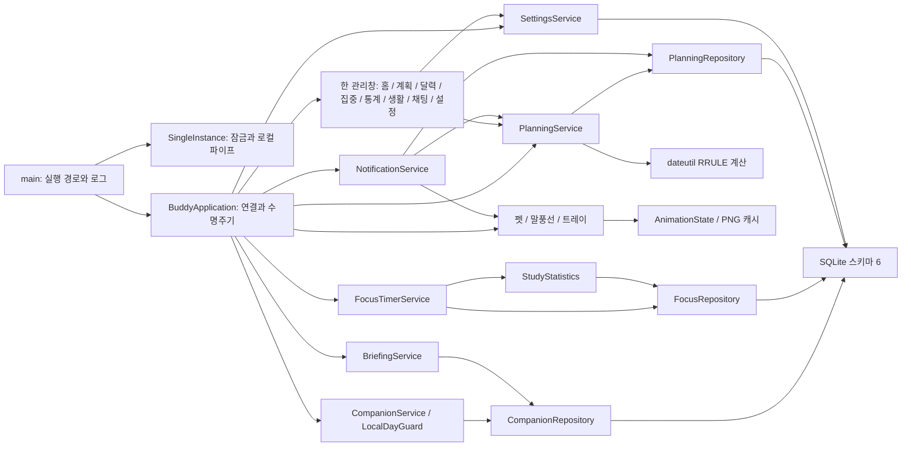

# 아키텍처 — 0.5.5

## 연결 구조

- `core/`: 브랜드/버전, 사용자 경로·번들 경로, 설정 검증, 독립 화면 좌표 계산.
- `models/planning.py`: Task, CalendarEvent, Category, Occurrence, Reminder. UI와 SQL을 포함하지 않는다.
- `database/store.py`, `migrations.py`: 설정과 스키마 이전. `planning_repository.py`: 계획·분류·예외·완료·알림 처리 이력의 SQL.
- `calendar/recurrence.py`: 범위가 제한된 반복 계산·분할·남은 횟수. `layout.py`: 시간 겹침 그룹과 표시 열 계산.
- `services/planning_service.py`: 검증, 트랜잭션, 발생 항목과 날짜별 완료, 범위 수정/삭제, 알림 후보.
- `services/notification_service.py`: 30초 간격 알림 확인, 중복 처리 이력, 시간대 제한과 일시중지. 외부 네트워크 요청은 없다.
- `ui/`: TodayPage, CalendarPage, TimelineView, 편집/범위/분류 대화상자. 한 관리창 안에서 데이터를 공유한다. SQL을 직접 호출하지 않는다.
- `tools/`: 자체 에셋, QA 전용 예시 화면, Windows Qt 수명주기 검사, Windows 버전 리소스.

## 저장소

`%LOCALAPPDATA%/DesktopBuddy/buddy.db`, `PRAGMA user_version = 6`.

| 테이블 | 역할 |
|---|---|
| app_settings | 타입·범위를 검증한 설정 JSON 값 |
| categories | 분류 이름·색상. 삭제 시 항목 FK는 NULL |
| tasks | 예정 날짜·선택 시간·마감·우선순위·반복 규칙·일회성 완료 |
| calendar_events | 시작·종료·종일 여부·반복 규칙·사전 알림 |
| recurrence_exceptions | task/event 중 하나만 소유, 원래 발생 날짜, 취소 또는 전체 개별 수정 스냅샷 |
| task_completions | 반복 할 일의 ID + 원래 날짜별 완료/취소 |
| notification_log | 알림 키별 처리 시각과 shown/suppressed 상태 |
| focus_sessions | 종류·예정/실제/일시정지·완료/중지·과목/할 일 스냅샷 |
| focus_segments | 재개부터 일시정지까지 실제 집중 구간, 동일 구간 체크포인트 UPDATE |
| timer_state | 단일 미완료 세션과 다음 단계·사이클·연결 정보 체크포인트 |

일정과 할 일은 별도 테이블이다. 집중은 세션과 실제 집중 구간을 나눠 저장한다. 항목과 분류 ID는 AUTOINCREMENT로 재사용하지 않아 이전 알림 이력·개별 스냅샷이 새 항목에 잘못 적용되는 것을 막는다.

SQLite foreign_keys와 트랜잭션을 사용한다. 이전 DB를 열 때 backup API로 원본 백업을 만든 뒤 명시적 BEGIN IMMEDIATE에서 DDL과 버전을 함께 이전한다. 실패하면 전체 롤백하고 DB를 초기화하지 않는다. 저장 성공 후에만 changed 신호를 발생시켜 화면을 갱신한다.

## 반복과 시간

RRULE은 [python-dateutil 공식 문서](https://dateutil.readthedocs.io/en/stable/rrule.html)의 계산기를 사용한다. UI에서 매일, 매주/요일, 매월 같은 날짜, 매년 같은 날짜, 간격·COUNT 또는 UNTIL을 설정한다. 시간보다 짧은 고빈도 반복은 허용하지 않는다.

실제 발생 항목을 여러 줄 복제 저장하지 않는다. 범위를 1~366일로 제한해 계산하며 무횟수 규칙은 간격 위상을 유지한 가까운 시작점으로 이동한다. 월말·윤년의 없는 날짜를 건너뛴다. ZoneInfo 시간대의 존재하지 않는 DST 시각도 제외하며 유효 COUNT에 포함하지 않는다. Windows용 tzdata를 번들에 포함한다.

DB의 이벤트/마감 시각은 UTC 문자열로 보관하고 각 레코드의 IANA 시간대로 반복한다. 화면은 현재 한국(서울) 시간이다. 일정을 자르는 날짜 구간은 [시작, 종료)이며 종일 편집창의 사용자 종료일은 포함해 해석한다. 자정을 넘는 일정은 양쪽 날짜에 나타난다.

발생 키는 **원래 지역 날짜**이다. 한 항목을 다른 달로 옮겨도 같은 키로 예외와 완료 상태를 유지한다. 이동한 예외는 원래 날짜가 조회 범위 밖이어도 실제 날짜로 조회한다.

이후 수정은 이전 규칙에 UNTIL을 붙이고 이후 구간을 새 원본으로 나눈다. 남은 COUNT를 계산하고 이후 개별 예외·완료·알림 처리 이력을 옮긴다. 전체 과정은 한 트랜잭션이다. 반복 중단 시 개별 수정과 이미 완료한 날짜는 일회성 항목으로 보존한다. 변경하지 않은 미래 반복은 규칙 변경에 따른 새 발생 결과를 따른다.

## 화면과 입력

기존 투명 펫은 [Qt QWidget 공식 API](https://doc.qt.io/qtforpython-6/PySide6/QtWidgets/QWidget.html)의 Tool/Frameless/TranslucentBackground와 캐시한 상태별 실루엣 마스크를 사용한다. 단일 클릭은 OS 더블클릭 판정 시간 뒤 실행하며 더블클릭/드래그는 대기를 취소한다. 숨김/움직임 줄이기에서 프레임 타이머를 멈춘다.

달력은 실제 6×7 날짜 칸과 선택 날짜 목록을 제공한다. 주/일 보기는 [Qt Graphics View](https://doc.qt.io/qtforpython-6/overviews/qtwidgets-graphicsview.html) 기반이다. 종일 영역을 고정하고 시간대만 스크롤한다. 겹침 연결 그룹을 여러 열로 배치하고 작은 블록의 글자는 영역 안으로 잘라 겹쳐 그리지 않는다. 실제 제목/시각은 툴팁과 선택 날짜 목록에서 확인한다.

추가·편집은 작은 대화상자를 사용하되 주 기능 화면은 하나의 관리창을 유지한다. 삭제는 범위 선택/확인 후 실행한다. 저장 실패 시 편집창과 입력 내용을 유지한다. 일반 닫기는 숨김이며 명시적 전체 종료에서만 close 이벤트를 허용한다. 종료는 타이머·창·트레이·잠금·DB를 정리한다.

## 알림의 범위

알림 키는 종류/ID/원래 발생 날짜/실제 트리거 시각이다. 앱 시작·복귀에서 최근 5분만 보고 처리 이력을 먼저 기록한다. 재시작·시계 역행·같은 범위 재확인으로 중복 발송하지 않는다. 동시 알림은 한 묶음으로 전달하고 조용한 시간의 알림은 억제 상태로 기록해 나중에 쌓아 띄우지 않는다.

QSystemTrayIcon 메시지를 사용하며 지원하지 않으면 관리창 상태 안내와 허용된 말풍선으로 전달한다. 앱이 완전히 종료되면 알림을 보내지 못한다. Windows 전체 방해 금지·시작 프로그램·백그라운드 서버는 변경하지 않는다. 실제 OS 토스트와 절전 하드웨어 동작은 수동 확인 대상이다.

## 미래 경계 — 미구현

개발자 제공 캐릭터 팩·첫 선택/변경은 0.5.2에 기존 설정 구조로 추가했다. AI BYOK 보안 저장, ICS와 공식 제공자 연동은 후속 단계다. 현재 API 키 입력·외부 전송·원격 텔레메트리는 없다.

## 집중 시간과 복구

`models/focus.py`는 Clock 프로토콜과 불변 타이머 스냅샷을 정의한다. `services/focus_timer.py`는 1초 QTimer와 monotonic 차이로 실제 진행을 측정한다. [Python 시간 문서](https://docs.python.org/3/library/time.html)에 따라 시간 측정만으로 절전을 구분할 수 없으므로 벽시계와 비교하고, 5초 초과 응답 공백·2초 초과 차이·역행을 감지하면 공백을 적립하지 않고 일시정지한다.

`power_events.py`는 [Windows WM_POWERBROADCAST](https://learn.microsoft.com/en-us/windows/win32/power/wm-powerbroadcast)의 절전/복귀 이벤트를 [Qt 네이티브 이벤트 필터](https://doc.qt.io/qtforpython-6/PySide6/QtCore/QAbstractNativeEventFilter.html)로 관찰한다. 시스템 전원 설정을 변경하지 않는다. 자동 재개하지 않는다.

5초와 상태 전환마다 진행과 구간을 트랜잭션으로 저장한다. 같은 연속 구간은 UPDATE하여 초마다 행을 만들지 않는다. 정상 종료는 마지막 진행을 저장한다. 강제 종료는 마지막 약 5초가 유실될 수 있지만 재시작 공백을 추가하지 않는다. 미완료 체크포인트는 일시정지로 복구하고, 고아 세션은 중단 처리한다. 저장 실패도 일시정지하며 오류를 안내한다.

`study_statistics.py`는 UTC 구간을 지역 자정 경계에서 나눠 monotonic 초를 비례 배분한다. 휴식 구간은 공부 통계에서 제외한다. 분류/할 일 삭제 뒤에도 저장한 이름으로 기록이 남고 기록 삭제는 CASCADE로 구간을 함께 제거한다. 분류 변경과 삭제 뒤 모든 집계를 다시 계산한다. 종료 기록의 시간 자체는 수동으로 바꾸지 않는다.

`FocusPage`, `StatisticsPage`, `MiniTimer`는 계산과 저장을 서비스에 맡긴다. 통계는 보이는 동안 체크포인트/날짜 주기에 갱신한다. 작은 타이머는 마우스 입력을 통과시키고 펫 위치·화면 작업 영역을 따른다. 애니메이션은 focus/break 기본 상태와 일회성 반응을 분리하여 반응 뒤 현재 기본 상태로 돌아간다.

빌드는 `assets/default_character`, `assets/icons`와 `assets/character_packs`의 고정 3종·각 5파일만 명시적으로 포함한다. 준비 중인 `assets/characters`의 사용자 자료가 배포본에 섞이지 않는다.

## 생활 상태와 안내 — PHASE 4

`models/companion.py`는 시간대 구간·휴식 제외 날짜 계산·불변 스냅샷을 정의한다. 휴식 구간을 합치고 요일별 주 수를 계산하므로 오래된 기록의 날짜를 하루씩 순회하지 않는다. `CompanionRepository`는 `rest_periods`, `companion_state`, `companion_messages`와 유효 집중 조회를 맡는다. 스키마 4는 focus_sessions.recorded를 기본 1로 추가해 기존 집중을 보존한다. 기록 off는 임시 복구만 저장하고 종료 시 세션을 제거하며, 통계/감정 조회는 recorded=1만 포함한다.

`CompanionService`는 실제 완료·기준 이상 시간을 확인하고 첫 사용자·기록 off·요일/휴식 기간·집중/휴식·수면을 적용한다. `LocalDayGuard`는 monotonic 대비 120초 초과 불연속과 재실행 역행, 미래 유효 기록을 감지해 중립 상태/자동 안내 중지를 유지하고 명시적 확인을 기다린다. 닫힌 동안의 시계 전진은 정상 경과와 구분할 수 없다.

`CompanionPresenter`는 선호 설정 사본으로 집중 중 크기/속도/표시를 적용한다. 실제 표시와 사용자의 표시 요청을 따로 보관해 자동 숨김 후 수동 숨김을 덮어쓰지 않는다. 캐릭터 찾기는 현재 정책 구간에서 직접 복구를 허용한다. MiniTimer의 정책 표시는 펫 표시와 분리되어 타이머만 모드를 지원한다. AnimationState는 기본 상태와 일회 반응의 우선순위를 분리한다.

`WindowsAttention`은 [Microsoft SHQueryUserNotificationState](https://learn.microsoft.com/en-us/windows/win32/api/shellapi/nf-shellapi-shqueryusernotificationstate)와 [공식 열거형](https://learn.microsoft.com/en-us/windows/win32/api/shellapi/ne-shellapi-query_user_notification_state)의 2/3/4 상태만 사용한다. API는 알림 적합성 휴리스틱이므로 모든 테두리 없는 영상/게임을 감지하지 못한다. 기본 off이며 2초 주기 조회에 창 제목·프로세스 내용·키 입력·화면 픽셀을 사용하지 않는다. 실패 시 숨김을 강제하지 않고 수동 경로를 안내한다.

`BriefingService`는 오늘 발생 항목·미완료·다가오는 일정·오늘 마감·공부 분류·이전 미완료를 실제 DB로 만든다. 자동 안내는 표시 전 날짜 처리 이력을 INSERT OR IGNORE로 확보한다. 조용한 상태에서는 같은 날만 기다리고, 실행 시 옵션은 시작 날짜에만 적용한다. 직접 보기도 오늘 처리 이력을 남기며 다시 열 수 있다. 카드에는 키보드 포커스를 강제로 주지 않는다. 한국(서울) 시간을 사용하고 자동 실행 등록이나 Windows 전체 알림 설정은 바꾸지 않는다.

## 오프라인 채팅 — PHASE 5A

`ui/chat_page.py`는 일반 텍스트 대화·입력·선택/확인과 보관/삭제 UI를 담당한다. `chat/parser.py`의 완전 일치 규칙은 허용된 명령만 `Intent`로 바꾸고, 날짜/시각/분 범위와 키 형태 본문을 검증한다. 외부 네트워크나 모델 호출은 없다. 미래 기능을 위한 AI 입력/선택 버튼은 제공하지 않는다.

`ChatService`는 조회, UUID 선택 카드와 확인 수명, 세션·보관 설정을 관리한다. 제안은 메모리에만 두며 5분 만료·새 명령/대화/보관 변경으로 무효화한다. 재시작 기록에는 작동하는 확인 컨트롤이 붙지 않는다. 동명 대상과 반복 범위를 결정한 뒤 `CommandExecutor`가 실제 기존 Planning/Focus 서비스를 호출한다. 변경 전 레코드·예외·완료·분류 또는 타이머 상태 지문을 다시 검증한다. 시간 경과만으로 타이머 중지 제안을 만료시키지 않는다.

| 새 테이블 | 역할 |
|---|---|
| chat_sessions | UUID·생성 시각·첫 입력에서 만든 짧은 대화 제목 |
| chat_messages | 세션 FK·사용자/앱·offline·본문·UTC 생성 시각, 세션/id 인덱스 |
| command_operations | 성공한 UUID·명령 종류·시각만 보존. 본문/항목 제목 없음 |

SQLite `Store.transaction()`은 가장 바깥에서 BEGIN IMMEDIATE/commit/rollback한다. 안쪽 실패를 잡았어도 rollback-only를 유지해 부분 커밋을 막는다. Planning/Focus는 이 경로를 공유하며 신호는 바깥 커밋 뒤 발행한다. Focus의 원자 상태 전환은 복구 훅으로 런타임·세션/구간 ID·연결 정보를 복원한다. 명령 변경·체크포인트·중복 방지 정보·성공 대화는 함께 저장한다. DB/보관 저장 또는 실제 커밋 실패 시 모두 롤백한다.

보관 off는 새 메시지 DB 저장을 하지 않으며 RAM 200개로 제한한다. 다시 켜면 새 대화에 저장하고 RAM 기록을 소급 저장하지 않는다. 대화는 최신 50개 단위, 세션 선택은 최근 50개를 조회한다. 대화 삭제는 세션/메시지만 지우며 실행 중복 방지 정보와 계획·집중은 유지한다. 기존 버전은 backup API 원본 백업 후 스키마 5로 이전한다.

## 대화 표현과 정보 분리 — 0.5.1

`characters/dialogue_profiles.py`는 고정 ID·표시 이름·설명, `dialogue_voice.py`는 상황별 문구·감정별 감탄사·표현 선택을 소유한다. 템플릿은 캐릭터/상황별로 순환하고 데이터를 전역 치환하지 않는다. `DialogueVoice.render(event, details, moru_text)`는 사실/기술 문자열인 details를 그대로 결합한다. 기본 모루는 기존 출력과 설정을 보존한다. 응답 속도를 바꾸기 위한 인위적인 대기는 없다.

`ChatService`는 실제 조회/실행 결과로 응답을 만들고 성공 대화/화자를 같은 트랜잭션에 저장한다. 커밋 뒤 선택이 바뀌어도 이미 작성한 응답의 화자 ID를 덮어쓰지 않는다. `chat_character_id`와 사진 팩의 `character_id`는 0.5.2부터 같은 고정 ID로 함께 선택한다. 기존 메시지를 새 캐릭터로 다시 쓰지 않는다.

스키마 6은 `chat_messages.character_id`와 `profile_version`을 기본 moru/1로 추가한다. 5→6 이전은 Store의 backup API·DDL 트랜잭션을 사용한다. 보관 off는 RAM 메시지와 화자 정보를 함께 최대 200개로 제한한다. 대화 보관 전환·말투 전환은 대기 카드를 취소하며 진행 타이머와 기존 기록은 보존한다.

`ChatPage`는 그림/말투 선택과 과거 화자 표시를 담당하며 현재 그림과 말투 이름을 표시한다. `PetWindow`와 완료/공백 안내도 같은 설정을 읽는다. 종료된 앱의 초기 인사 콜백은 실행하지 않으며 Qt 컨텍스트가 제거되면 취소한다. AI 연결은 미구현이며 말투 규칙은 [대화 명세](docs/CHARACTER_DIALOGUE.md)를 따른다.

## 캐릭터 팩과 타이머 표시 — 0.5.2

`CharacterCatalog`는 고정 ID에 대응하는 로컬 팩만 읽는다. `PackDecoder`는 PNG 한 파일 8 MiB·개별 프레임 1,024px·아틀라스 4,096px/4,194,304픽셀·전체 64프레임·디코딩 예산 64 MiB를 제한하고 폴더 밖 경로를 거부한다. 헤더를 먼저 검사하고 투명도/빈 프레임/좌표/지연을 확인한다. 런타임 프레임은 256×256으로 정규화하며 누락 상태는 명시적 alias로 같은 캐릭터의 idle을 사용한다.

`CharacterService`는 새 클립과 `PetWindow.prepare_pack`의 크기별 이미지·마스크를 준비한 뒤 설정을 저장하고 교체 신호를 보낸다. 저장·준비 실패 시 기존 팩을 유지한다. `CompanionPresenter`가 현재 집중/수면/숨김 정책을 다시 적용하며 타이머 서비스는 교체하지 않는다. 기본 이름만 새 캐릭터 이름을 따르고 사용자 별명은 유지한다.

`CharacterPage`는 상태별 정적 미리보기와 선택을 제공한다. 첫 실행의 `CharacterPicker`는 비차단 대화상자이며 나중에 선택하면 다음 실행에 다시 안내한다. 기존 설정은 첫 선택을 강제하지 않는다. `character_id`, `chat_character_id`, `character_selection_done`, `mini_timer_style`은 기존 설정 저장 구조를 사용해 스키마 6을 유지한다.

`AnimationState.frame_delay_ms`가 각 프레임의 재생 시간을 제공한다. `PetWindow`는 숨김 시 재생을 멈추며 전환 때 캐시를 교체한다. `MiniTimer`의 원형 표시는 같은 타이머 스냅샷을 그리며 별도 고빈도 시계나 독립 카운트다운을 만들지 않는다. 프리셋/우클릭도 기존 `FocusTimerService`를 호출한다.

## 마우스 시선과 선택형 이동 — 0.5.4

`characters/behavior.py`는 화면 좌표와 독립적으로 16방향 계산·경계 히스테리시스·유한 좌우 경로를 계산한다. 방향은 북쪽부터 시계 방향이며 정지 포즈 `look`은 manual 클립이다. `AnimationState.show_ambient`는 기본 idle에서만 동작하고 같은 기본 상태 갱신에는 유지하되 직접 반응·새 기본 상태에 양보한다. `advance`는 manual 클립을 순환하지 않는다.

`PetBehavior`는 포인터를 120ms 간격으로 확인하고 이동 중에만 33ms 주기를 사용한다. 입력 훅·좌표 저장·전송은 없다. 시선과 이동이 모두 비활성/미지원이거나 숨김·수면·집중·조용한 상태면 타이머를 정지한다. 이동은 현재 모니터 작업 영역의 수평 경로만 만들며 0.5초 초과/음수 시간 공백에는 경로를 버린다. UI 재배치·크기/팩 전환·직접 입력이 경로를 무효화한다.

`PetWindow`는 포즈·마스크·드래그/메뉴 상태·실제 창 이동을 담당한다. `geometry_changed`로 작은 타이머가 따라오며 이동 종료/중단 때만 위치 저장 신호를 보낸다. 좌표 보정은 저장된 위치와 다를 때만 신호를 보내 중복 저장 요청을 막는다. `cursor_look_enabled=True`, `roaming_enabled=False`는 기존 설정 구조를 사용하며 DB 스키마 6을 유지한다.

## 완료 축하와 소리 — 0.5.5

`CharacterCatalog`는 검증된 complete/happy 프레임을 참조하는 celebrate 클립을 구성한다. 새 PNG 디코딩 없이 점프 두 번·인사 두 번을 반복한다. 원본 팩의 64프레임·메모리 제한은 유지한다. `AnimationState.held`는 같은 기본 상태 갱신에서 공연을 유지하고 직접 반응·새 기본 상태·팩 전환에 양보한다.

`CompletionService`는 실제 커밋 후 phase_finished와 명시적 미리보기를 처리한다. 완료 키 64개를 메모리에 보관해 중복을 막는다. 미리보기는 DB를 수정하지 않는다. 새 타이머/초기화·직접 조작·캐릭터/축하 설정 변경·숨김/조용한 정책·2초 초과/역행 공백·전원·종료 때 정리한다. 자동 다음 단계는 계산을 지연하지 않고 짧게만 반응한다. 음악은 완료한 집중에만 붙인다.

`WavePlayer`는 고정 3종의 로컬 WAV를 검증하고 Windows 비동기 재생을 호출한다. 파일당 12 MiB, 48kHz/2채널/16bit PCM·고정 길이·경로 이탈·잘린 파일을 확인하며 시스템 기본 소리로 대체하지 않는다. 재생 실패는 알리고 무음으로 진행한다. 파이썬 기본 기능을 사용하므로 런타임 오디오 디코더를 추가하지 않는다. soundfile을 사용하는 변환 도구는 개발 전용이다. 빌드는 WAV 세 파일을 명시적으로 포함한다.

`FocusPage`는 선택·미리보기·중지와 같은 카드 안의 오류 안내를 제공한다. 설정 실패 때 UI 선택을 복구하며 미리보기 오류를 타이머 저장 오류로 처리하지 않는다. completion_style 기본 simple, completion_sound_enabled 기본 false이며 기존 설정 구조와 DB 스키마 6을 유지한다.

## 선택형 온라인 텍스트 — 0.6.1

`OnlineService`가 현재 요청 ID·모드·모델·취소/지연 응답을 관리한다. `OnlineJob`의 daemon 작업 스레드는 별도 asyncio 루프에서 키를 읽고 `ResponsesClient`를 실행한다. 키와 원시 SDK 예외는 Qt 신호에 전달하지 않는다. 키 검사 후 요청 ID로 GUI의 저장 승인을 기다리고, `ChatService.begin_online`의 저장이 성공해야 HTTP를 시작한다. 응답 저장도 GUI의 `accept_online`에서 수행한다.

`OpenAITransport`는 고정 HTTPS Responses 경로·TLS·리다이렉트 금지·환경 프록시 무시·1 MiB 제한을 맡는다. SDK/HTTP 재시도는 끈다. 이전 대화/DB를 요청에 첨부하지 않고 도구를 허용하지 않는다. 전체 60초 제한과 취소를 사용하며 강제 스레드 종료나 GUI의 join 대기는 하지 않는다. 이미 전송된 요청/요금 취소는 보장하지 않는다.

`characters/ai_persona.py`가 말투 지침과 우사기 외곽 형식을 담당한다. 응답의 명령 문장은 실행기에 연결하지 않는다. 기존 스키마 6의 메시지 mode와 화자 메타데이터를 사용하며 과거 답변을 다시 작성하지 않는다. 비밀이 아닌 모델 ID만 설정에 저장하고 온라인 활성화는 실행 중에만 유지한다.
