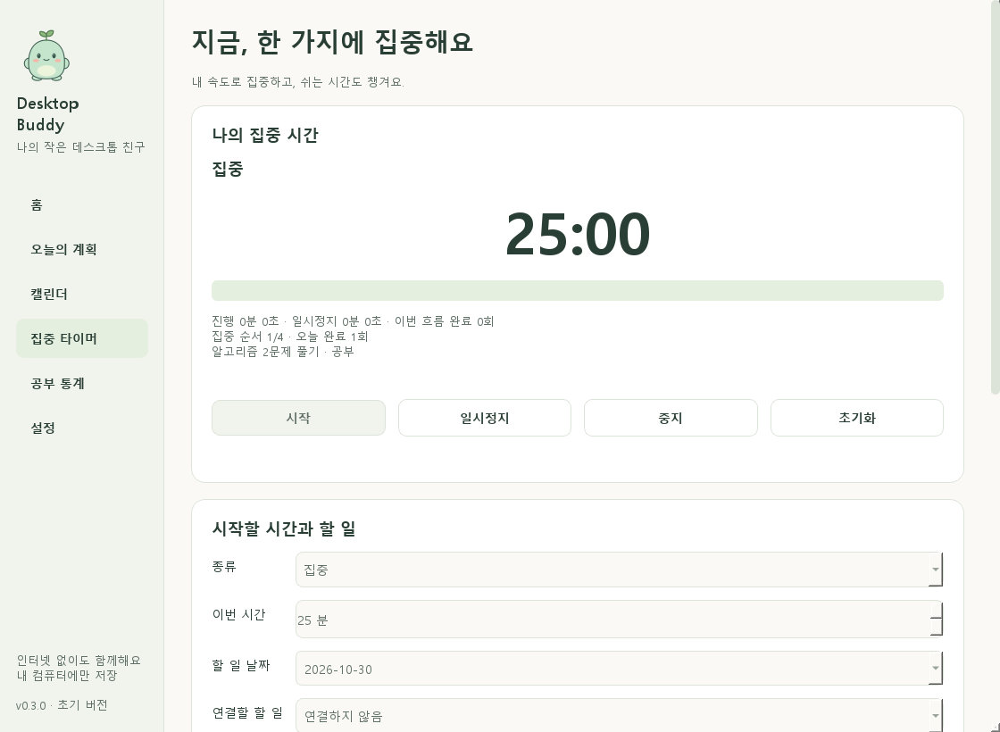
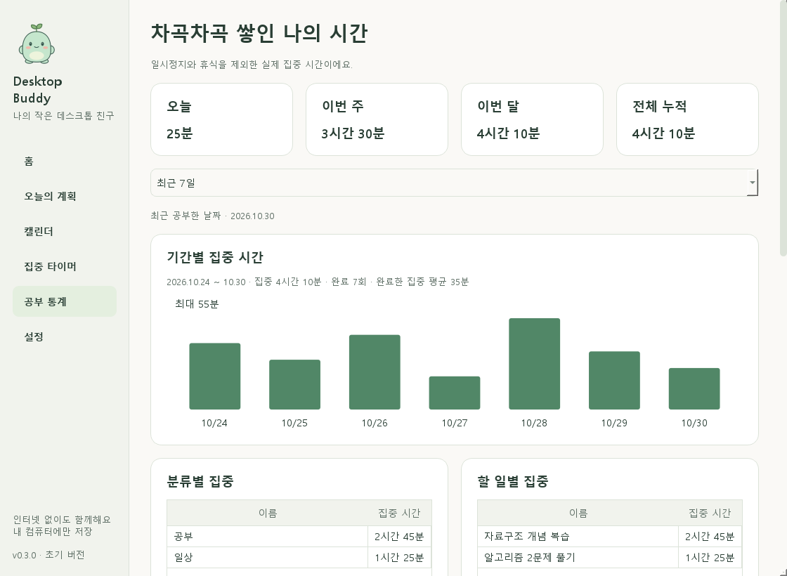

# Desktop Buddy 0.3.0

소스 저장소: [ksmin4347/Chiikawa_buddy](https://github.com/ksmin4347/Chiikawa_buddy)

작은 캐릭터와 하루 계획을 함께 관리하는 한국어 Windows 데스크톱 앱입니다. **PHASE 0·1·2·3**를 구현했습니다. 인터넷·회원가입·API 키 없이 캐릭터, 할 일, 캘린더, 집중 타이머와 공부 통계를 사용할 수 있습니다.

기본 캐릭터 모루는 직접 그린 오리지널 마스코트입니다. 먼작귀 공식 이미지는 포함하지 않습니다. 채팅과 제공 캐릭터 선택은 아직 구현하지 않았습니다. 개발자가 제공할 치이카와·하치와레·우사기 자료는 [캐릭터 준비 폴더](assets/characters/README.md)에 넣습니다.



위 화면과 문서의 이미지는 전용 QA 데이터로 만든 예시입니다. 실제 첫 실행에는 예시 할 일이나 일정이 자동 등록되지 않습니다.

## 실행

이 PC에서는 **`run_windows.bat`을 더블클릭**하세요. 작은 캐릭터를 더블클릭하면 관리창이 열립니다.

처음 소스를 받았거나 0.1.0 개발 환경에서 업데이트했다면 Python 3.12 이상을 설치한 뒤 `setup_windows.bat` → `run_windows.bat` 순서로 실행합니다. 준비에는 인터넷이 필요하며, 앱 실행에는 인터넷이 필요하지 않습니다.

`build_windows.bat`은 테스트 후 `dist\DesktopBuddy` 폴더를 만듭니다. Python 없는 PC용 one-folder EXE 후보이며 폴더 전체가 필요합니다. **이 PC에서 이전 EXE는 Windows 앱 제어 정책으로 차단되었습니다. 0.3.0도 빌드와 포함 파일을 확인했지만 EXE 실행·깨끗한 PC 검증은 완료하지 않았습니다.** 현재 확인된 실행 경로는 소스 실행입니다.

## 지금 사용할 수 있는 기능

| 화면 | 기능 |
|---|---|
| 캐릭터 | 클릭 인사, 더블클릭 관리창, 드래그, 우클릭·트레이, 숨김/복원 |
| 홈 | 실제 오늘 할 일 수·완료 수, 남은 일정, 계획·달력 바로가기 |
| 오늘의 계획 | 제목만 빠른 추가, 상세 편집, 삭제 확인, 완료/취소, 날짜 변경, 전체/미완료/완료/이전 미완료 필터 |
| 캘린더 | 실제 월간 7열 달력, 주간·일간 시간표, 날짜 이동, 선택 날짜 전체 목록, 종일·자정 넘김·겹치는 일정 |
| 반복 | 매일·매주/요일 선택·매월·매년, 간격·횟수·종료일, 이번만/이후/전체 수정·삭제, 날짜별 완료 |
| 카테고리 | 이름·색상 추가/수정, 분류 삭제 후 항목 보존 |
| 알림 | 일정 시작·할 일 마감 사전 알림, 중복 방지, 앱 알림 일시중지·방해 금지 시간 |
| 집중 타이머 | 집중·짧은/긴 휴식, 자유 시간, 일시정지·재개·중지·초기화, 선택형 뽀모도로 자동 진행, 할 일 연결 |
| 공부 통계 | 일/주/월/누적, 7·30일/8주/6개월 그래프, 분류·할 일별 비교, 공부 달력, 기록 분류 수정·삭제 |
| 작은 타이머 | 항상/집중 중/마우스 올림/숨김, 캐릭터 이동 연동, 마우스 입력 통과 |
| 설정 | 이름·크기·속도·정지 이미지·말풍선·항상 위·시작 표시·테마·주 시작 요일 |

날짜가 지난 미완료 항목은 자동 완료되거나 사라지지 않습니다. '이전 미완료'에서 확인하고 수정 창의 예정 날짜를 바꿀 수 있습니다. 반복 항목의 수정·삭제 범위는 원래 발생 날짜를 기준으로 합니다. 개별로 옮긴 날짜도 원래 항목과 연결됩니다.

31일의 매월 반복은 31일이 없는 달을 건너뜁니다. 2월 29일 매년 반복은 윤년에 나타납니다. 반복을 중단할 때 개별 수정과 이미 완료한 날짜는 독립 항목으로 보존합니다.

## 알림과 시간

- 화면은 **한국(서울) 시간** 기준입니다. 저장과 계산은 시간대 정보를 구분합니다.
- 할 일 알림은 상세 입력의 **마감 시각**, 일정 알림은 **시작 시각**을 기준으로 합니다.
- 앱이 완전히 종료되면 알림을 보내지 못합니다. 관리창만 닫으면 계속 동작합니다.
- Windows 알림 표시 여부는 OS 설정에도 영향을 받습니다. 실제 토스트 표시는 수동 확인이 남아 있습니다.
- 시작·복귀 시 최근 5분 이내 알림만 확인합니다. 오래된 알림을 몰아서 띄우지 않습니다.
- 방해 금지 중 알림은 나중에 다시 쌓아 띄우지 않습니다. 시작/종료가 같으면 시간대 제한을 적용하지 않습니다.
- 시작 프로그램과 Windows의 시스템 알림 설정은 자동으로 변경하지 않습니다.

## 집중과 공부 기록

관리창의 **집중 타이머**에서 시간을 정하고 시작합니다. 기본은 집중 25분/짧은 휴식 5분/4회마다 긴 휴식 15분입니다. 자동 진행은 기본 꺼짐이며, 완료 후 다음 단계를 누르거나 휴식을 건너뛸 수 있습니다. 할 일 날짜와 항목·분류를 선택하면 시작한 기록에 연결됩니다.

일시정지와 휴식은 공부 시간에서 제외합니다. 5초를 넘긴 응답 공백·시계 변경·Windows 절전 신호에는 타이머를 멈춥니다. 앱 재시작은 **일시정지 상태로 복구**하며 닫혀 있던 시간을 추가하지 않습니다. 정상 종료는 마지막 진행을 저장하고, 강제 종료에서는 마지막 체크포인트 뒤 약 5초가 사라질 수 있습니다.

공부 통계는 중지한 집중도 포함합니다. 완료 횟수와 평균은 선택 기간에 완료한 집중만 기준으로 합니다. 자정을 넘은 집중은 서울 날짜별로 나눕니다. 최근 100개 기록에서 종료한 기록의 분류를 바꾸거나 확인 후 삭제할 수 있습니다. 삭제는 그래프·누적에 즉시 반영됩니다. 초기화는 현재 흐름만 초기화하고 과거 기록을 지우지 않습니다.



## 데이터 안전성

기본 저장 위치는 `%LOCALAPPDATA%\DesktopBuddy\`입니다. `buddy.db`에 설정·위치·계획·일정·반복 예외·알림 처리 이력·집중 세션·실제 집중 구간을 저장합니다. 설치 폴더를 교체해도 유지됩니다. 오류 로그는 `logs\app.log`에 크기를 제한해 보관합니다.

0.1.0/0.2.0 DB를 처음 열 때 **원본 백업을 만든 뒤 스키마 3으로 이전**합니다. 실패 시 트랜잭션을 되돌리고 원본 DB를 초기화하지 않습니다. 백업은 같은 폴더의 `buddy.<시각>.backup.db`입니다. 이전 버전 프로그램은 새 스키마 DB를 열지 못하므로, 복구가 필요하면 원본·백업을 보관한 채 문의해 주세요. 백업/복원 UI는 후속 단계입니다.

## 개발·검증

```powershell
.\.venv\Scripts\python.exe -m pytest -q
.\.venv\Scripts\python.exe -m ruff check .
.\.venv\Scripts\python.exe -m ruff format --check .
.\.venv\Scripts\python.exe tools\render_preview.py
.\.venv\Scripts\python.exe tools\native_smoke.py
```

자동 테스트 **108개 통과**, 코드 품질 검사 통과. Windows Qt 자체 검증으로 계획/캘린더, 집중 시작·일시정지·재개·중지, 작은 타이머, 기록 표시, 종료 시 체크포인트와 타이머 정리를 확인했습니다. 실제 마우스·트레이·OS 토스트·실기기 절전·여러 모니터·전체 배율·Windows 10·EXE 실행 검증은 남아 있습니다.

기존 테스트 임시 폴더의 권한 문제가 있다면 새 경로로 검증할 수 있습니다.

```powershell
$buddyTestPath = Join-Path $env:TEMP ('desktop-buddy-tests-' + [guid]::NewGuid().ToString('N'))
.\.venv\Scripts\python.exe -m pytest -q -p no:cacheprovider --basetemp $buddyTestPath
```

사용자 DB를 테스트에 사용하지 않습니다. 화면 예시도 `.qa`의 별도 DB를 사용합니다.

## 문서

[실행·사용 안내](docs/WINDOWS_GUIDE.md) · [검증 기록](docs/TEST_REPORT.md) · [수동 확인](docs/MANUAL_TESTS.md) · [구조](ARCHITECTURE.md) · [요구사항](REQUIREMENTS.md) · [로드맵](ROADMAP.md) · [변경 기록](CHANGELOG.md) · [원본 명세](docs/MASTER_SPEC.md)

다음은 PHASE 4(감정·수면·공부 공백·아침 브리핑)이며 별도 요청 후 진행합니다.
