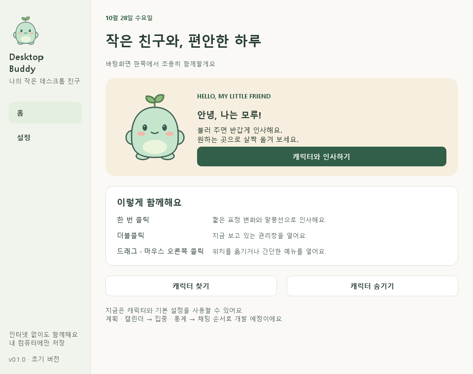

# Desktop Buddy 0.1.0

소스 저장소: [ksmin4347/Chiikawa_buddy](https://github.com/ksmin4347/Chiikawa_buddy)

화면 한쪽에서 조용히 함께하는 Windows 데스크톱 캐릭터입니다. 기본 캐릭터 **모루**는 이 프로젝트에서 직접 그린 오리지널 마스코트입니다.

현재 **PHASE 0·1 초기 구현**을 제공합니다. 인터넷, 회원가입, API 키 없이 실행됩니다. 일정·집중 타이머·채팅·사용자 이미지 가져오기는 아직 구현하지 않았습니다.



## 바로 실행하기

이 PC에서는 [run_windows.bat](run_windows.bat)을 더블클릭하세요. 처음에 큰 창이 열리지 않고 화면 오른쪽 아래에 작은 캐릭터가 나타납니다.

Python이 없는 PC에서는 `dist\DesktopBuddy\DesktopBuddy.exe`를 실행하세요. 이 EXE는 초기 검증용 one-folder 빌드입니다. **DesktopBuddy 폴더 전체**가 필요합니다. 정식 배포 품질 검증은 PHASE 8에서 진행합니다. **현재 PC에서는 Windows 앱 제어 정책이 새 EXE의 실행을 차단해 실행 검증을 완료하지 못했습니다. 이 PC에서는 우선 `run_windows.bat`을 사용하세요.**

소스를 다른 PC에서 실행하려면 Python 3.12 이상을 설치하고 `setup_windows.bat` → `run_windows.bat` 순서로 실행하세요. 설치 준비에는 인터넷이 필요하지만 앱 실행에는 인터넷이 필요하지 않습니다. 오류가 나면 실행 창이 유지됩니다.

## 사용 방법

| 조작 | 동작 |
|---|---|
| 캐릭터 한 번 클릭 | 짧은 기쁨 애니메이션과 인사 |
| 캐릭터 더블클릭 | 하나의 통합 관리창 열기 |
| 드래그 | 위치 이동 및 자동 저장 |
| 마우스 오른쪽 클릭 | 관리창, 인사, 위치 복구, 숨기기, 종료 |
| 트레이 한 번 클릭 | 숨기기 / 다시 표시 |
| 트레이 더블클릭 | 관리창 열기 |
| 관리창 닫기 | 관리창만 숨김, 캐릭터와 트레이 계속 실행 |
| 메뉴의 프로그램 종료 | 위치 저장 후 전체 종료 |

트레이는 작업표시줄 오른쪽의 숨겨진 아이콘 영역에 있을 수 있습니다. 캐릭터를 찾을 수 없으면 앱을 다시 실행하세요. 기존 실행을 불러오고 관리창을 표시합니다.

설정에서 이름, 크기, 움직임 속도, 움직임 줄이기, 말풍선, 항상 위에 표시, 시작 시 캐릭터 표시, 밝은/어두운 테마를 바꿀 수 있습니다. 이름은 Enter 또는 다른 항목을 클릭하면 저장됩니다. 다른 선택은 즉시 저장됩니다.

## 저장 위치

- 기본: `%LOCALAPPDATA%\DesktopBuddy\`
- 설정·위치: `buddy.db` (SQLite)
- 오류 기록: `logs\app.log` (크기 제한 및 순환 보관)
- 설치·소스 폴더 밖에 저장하므로 EXE 교체 후에도 유지됩니다.
- 시작 프로그램 등록이나 외부 전송을 하지 않습니다.
- 테스트는 별도 임시 폴더 또는 `.qa`를 사용합니다.
- 저장 오류 시 사용자 DB를 초기화하지 않습니다. 문제가 있으면 원본을 보관한 채 [실행 안내](docs/WINDOWS_GUIDE.md)를 확인하세요.

## 개발 및 검증

```powershell
.\.venv\Scripts\python.exe -m pytest -q
.\.venv\Scripts\python.exe -m ruff check .
.\.venv\Scripts\python.exe -m ruff format --check .
.\.venv\Scripts\python.exe tools\render_preview.py
.\.venv\Scripts\python.exe tools\native_smoke.py
```

- 테스트된 환경: Windows 11, Python 3.12.14, PySide6 6.12.0.
- PySide6의 Essentials 배포판만 런타임 의존성으로 사용합니다. 브라우저 엔진은 필요하지 않습니다.
- 자동 테스트와 Windows 네이티브 Qt 자체 검증을 수행했습니다. **실제 마우스 조작, 트레이 클릭, 다중 모니터 연결/제거, 전체 DPI 배율, Windows 10은 수동 확인이 남아 있습니다.**
- 자세한 결과와 한계: [검증 기록](docs/TEST_REPORT.md), [수동 체크리스트](docs/MANUAL_TESTS.md).
- `build_windows.bat`은 테스트 후 PyInstaller로 one-folder 배포 폴더를 만듭니다.

## 프로젝트 문서

- [원본 전체 명세](docs/MASTER_SPEC.md)
- [요구사항 및 현재 구현 범위](REQUIREMENTS.md)
- [구조와 데이터 설계](ARCHITECTURE.md)
- [단계별 계획과 완료 조건](ROADMAP.md)
- [개발 규칙](AGENTS.md), [변경 기록](CHANGELOG.md)
- [Windows 초보자 안내](docs/WINDOWS_GUIDE.md), [배포 안내](docs/DISTRIBUTION.md)
- [캐릭터 에셋 설명](assets/README.md)

다음 단계는 PHASE 2(하루 계획·실제 캘린더)입니다. 사용자 요청 전에는 진행하지 않습니다.
