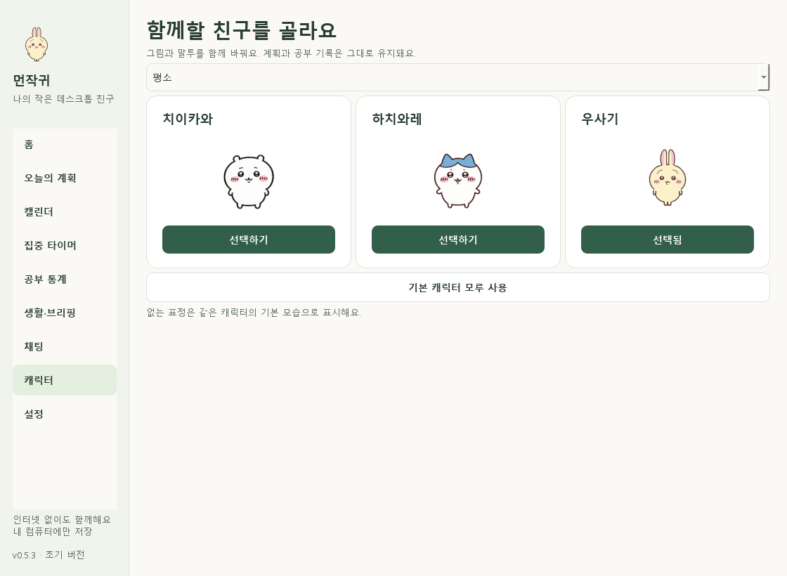
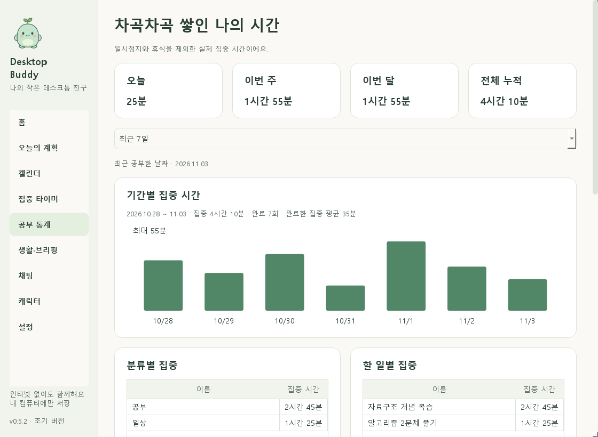
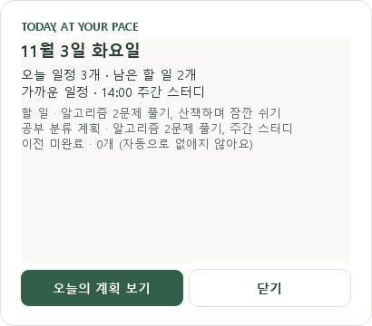
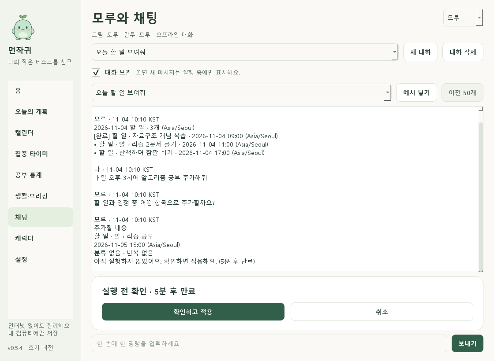
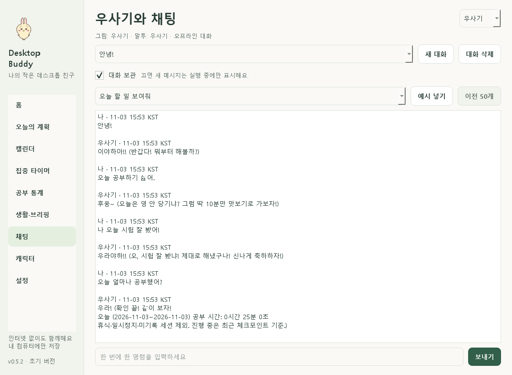
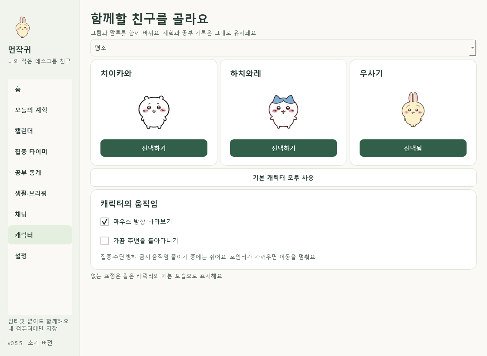
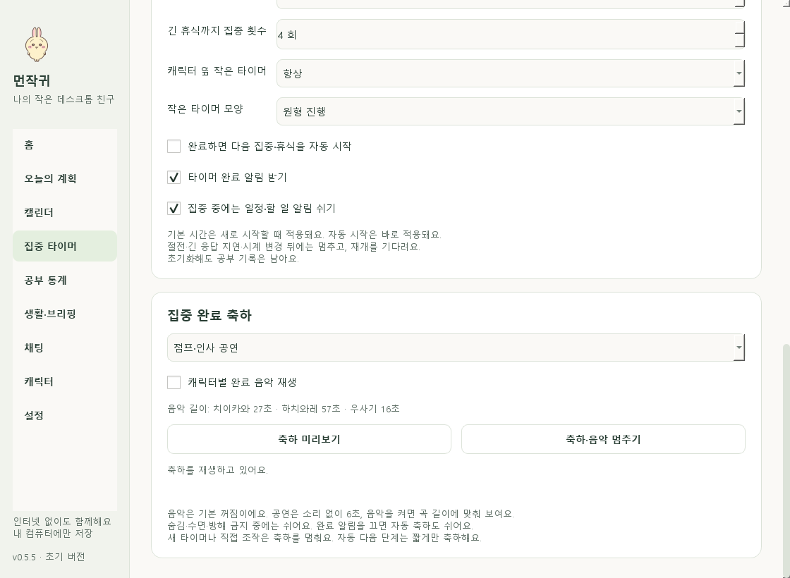

# 먼작귀 0.5.7

소스 저장소: [ksmin4347/Chiikawa_buddy](https://github.com/ksmin4347/Chiikawa_buddy)

작은 캐릭터와 하루 계획을 함께 관리하는 한국어 Windows 데스크톱 앱입니다. **PHASE 0~4와 PHASE 5A·5B 오프라인 채팅·제공 캐릭터 선택**을 구현했습니다. 인터넷·회원가입·API 키 없이 캐릭터, 할 일, 캘린더, 집중 타이머와 공부 통계를 사용할 수 있습니다.

처음 실행하면 **치이카와·하치와레·우사기** 중 함께할 캐릭터를 고릅니다. 실제 그림·상황별 움직임·대화 말투가 함께 바뀌고 다음 실행에도 유지됩니다. 관리창의 **캐릭터** 메뉴에서 바꾸거나 기본 모루를 사용할 수 있습니다. 채팅은 오프라인 명령 모드이며 자유 AI 대화는 후속 단계입니다.

관리창은 **Ctrl+1~9**로 메뉴를 옮기고, **Ctrl+L**로 채팅 입력에 이동합니다. 채팅 확인은 **Ctrl+Enter**, 카드 취소는 **Escape**, 안내는 **F1**입니다. [키보드·접근성 사용법](docs/KEYBOARD_GUIDE.md)을 참고하세요.



위 화면과 문서의 이미지는 전용 QA 데이터로 만든 예시입니다. 실제 첫 실행에는 예시 할 일이나 일정이 자동 등록되지 않습니다.

## 5·6단계 설계와 사진 준비

[채팅·캐릭터·AI 설계서](docs/PHASE_5_6_DESIGN.md)와 [사진 넣는 방법](assets/characters/README.md)을 정리했습니다. 0.5.2에는 5B 실제 3종 팩과 첫 선택 화면을 연결했습니다. 사진은 개발자가 준비하고, 앱 사용자는 제공 목록에서 고릅니다. [캐릭터 선택·상태 안내](docs/CHARACTER_GUIDE.md)에서 현재 모습과 새 팩 구성법을 확인할 수 있습니다. 6단계 AI 연결은 설계 상태입니다.

## 실행

이 PC에서는 **`run_windows.bat`을 더블클릭**하세요. 작은 캐릭터를 더블클릭하면 관리창이 열립니다.

이 PC의 바탕화면에는 **먼작귀** 바로가기를 만들었습니다. 손을 흔드는 우사기 아이콘을 더블클릭하면 검은 콘솔 창 없이 실행합니다. 관리창·첫 선택·브리핑·작은 타이머의 표시 이름도 먼작귀이며, 앱 아이콘은 선택한 펫과 관계없이 우사기를 사용합니다. 기존 `%LOCALAPPDATA%\DesktopBuddy` 데이터 위치는 유지합니다.

처음 소스를 받았거나 0.1.0 개발 환경에서 업데이트했다면 Python 3.12 이상을 설치한 뒤 `setup_windows.bat` → `run_windows.bat` 순서로 실행합니다. 준비에는 인터넷이 필요하며, 앱 실행에는 인터넷이 필요하지 않습니다.

`build_windows.bat`은 테스트 후 `dist\DesktopBuddy` 폴더를 만듭니다. Python 없는 PC용 one-folder EXE 후보이며 폴더 전체가 필요합니다. **이 PC에서 이전 EXE는 Windows 앱 제어 정책으로 차단되었습니다. 0.5.7도 빌드와 포함 파일을 확인했지만 EXE 실행·깨끗한 PC 검증은 완료하지 않았습니다.** 현재 확인된 실행 경로는 소스 실행입니다.

## 지금 사용할 수 있는 기능

| 화면 | 기능 |
|---|---|
| 캐릭터 | 3종 그림·말투 선택/복원, 상태 미리보기, 클릭 인사, 더블클릭 관리창, 드래그, 우클릭·트레이, 숨김/복원 |
| 홈 | 실제 오늘 할 일 수·완료 수, 남은 일정, 계획·달력 바로가기 |
| 오늘의 계획 | 제목만 빠른 추가, 상세 편집, 삭제 확인, 완료/취소, 날짜 변경, 전체/미완료/완료/이전 미완료 필터 |
| 캘린더 | 실제 월간 7열 달력, 주간·일간 시간표, 날짜 이동, 선택 날짜 전체 목록, 종일·자정 넘김·겹치는 일정 |
| 반복 | 매일·매주/요일 선택·매월·매년, 간격·횟수·종료일, 이번만/이후/전체 수정·삭제, 날짜별 완료 |
| 카테고리 | 이름·색상 추가/수정, 분류 삭제 후 항목 보존 |
| 알림 | 일정 시작·할 일 마감 사전 알림, 중복 방지, 앱 알림 일시중지·방해 금지 시간 |
| 집중 타이머 | 집중·짧은/긴 휴식, 자유 시간, 일시정지·재개·중지·초기화, 선택형 뽀모도로 자동 진행, 할 일 연결 |
| 공부 통계 | 일/주/월/누적, 7·30일/8주/6개월 그래프, 분류·할 일별 비교, 공부 달력, 기록 분류 수정·삭제 |
| 작은 타이머 | 막대형·원형 진행, 항상/집중 중/마우스 올림/숨김, 캐릭터 이동 연동, 마우스 입력 통과 |
| 생활·브리핑 | 공부 공백 표정·휴식일/기간, 수면, 집중 중 표시, 선택형 자동 숨김, 하루 브리핑 |
| 채팅 | 한국어 지원 명령, 일정·공부 조회, 타이머 제어, 변경 확인, 대화 보관·삭제 |
| 설정 | 이름·크기·속도·정지 이미지·말풍선·항상 위·시작 표시·테마·주 시작 요일 |

날짜가 지난 미완료 항목은 자동 완료되거나 사라지지 않습니다. '이전 미완료'에서 확인하고 수정 창의 예정 날짜를 바꿀 수 있습니다. 반복 항목의 수정·삭제 범위는 원래 발생 날짜를 기준으로 합니다. 개별로 옮긴 날짜도 원래 항목과 연결됩니다.

31일의 매월 반복은 31일이 없는 달을 건너뜁니다. 2월 29일 매년 반복은 윤년에 나타납니다. 반복을 중단할 때 개별 수정과 이미 완료한 날짜는 독립 항목으로 보존합니다.

## 알림과 시간

- 화면은 **한국(서울) 시간** 기준입니다. 저장과 계산은 시간대 정보를 구분합니다.
- 할 일 알림은 상세 입력의 **마감 시각**, 일정 알림은 **시작 시각**을 기준으로 합니다.
- 앱이 완전히 종료되면 알림을 보내지 못합니다. 관리창만 닫으면 계속 동작합니다.
- Windows 알림 표시 여부는 OS 설정에도 영향을 받습니다. 실제 토스트 표시는 수동 확인이 남아 있습니다.
- 시작·복귀 시 최근 5분 이내 알림만 확인합니다. 오래된 알림을 몰아서 띄우지 않습니다.
- 방해 금지 중 알림은 나중에 다시 쌓아 띄우지 않습니다. 시작/종료가 같으면 시간대 제한을 적용하지 않습니다.
- 시작 프로그램과 Windows의 시스템 알림 설정은 자동으로 변경하지 않습니다.

## 집중과 공부 기록

관리창의 **집중 타이머**에서 시간을 정하고 시작합니다. **15·25·30·60분** 버튼은 이번 시간을 채우며, 캐릭터 우클릭의 **집중 바로 시작**은 해당 시간으로 시작합니다. 우클릭으로 일시정지·재개·중지도 할 수 있습니다. 작은 타이머 모양은 막대형 또는 원형 진행으로 고릅니다. 기본은 집중 25분/짧은 휴식 5분/4회마다 긴 휴식 15분입니다. 자동 진행은 기본 꺼짐이며, 완료 후 다음 단계를 누르거나 휴식을 건너뛸 수 있습니다. 할 일 날짜와 항목·분류를 선택하면 시작한 기록에 연결됩니다.

일시정지와 휴식은 공부 시간에서 제외합니다. 5초를 넘긴 응답 공백·시계 변경·Windows 절전 신호에는 타이머를 멈춥니다. 앱 재시작은 **일시정지 상태로 복구**하며 닫혀 있던 시간을 추가하지 않습니다. 정상 종료는 마지막 진행을 저장하고, 강제 종료에서는 마지막 체크포인트 뒤 약 5초가 사라질 수 있습니다.

공부 통계는 중지한 집중도 포함합니다. 완료 횟수와 평균은 선택 기간에 완료한 집중만 기준으로 합니다. 자정을 넘은 집중은 서울 날짜별로 나눕니다. 최근 100개 기록에서 종료한 기록의 분류를 바꾸거나 확인 후 삭제할 수 있습니다. 삭제는 그래프·누적에 즉시 반영됩니다. 초기화는 현재 흐름만 초기화하고 과거 기록을 지우지 않습니다.



## 생활·브리핑

새 메뉴에서 생활에 맞는 옵션을 정합니다.

- **공부 공백 표정:** 기본 15분 이상 실제로 완료한 집중을 유효하게 봅니다. 첫 유효 집중 전에는 시무룩해지지 않습니다. 기본 주말과 지정한 휴식 기간은 공백에서 제외하고, 2일째 걱정·3일째 시무룩함을 표시합니다. 집중 중에는 공부 모습이 우선합니다.
- **안부:** 기본 3일 간격이며, 숨김·집중·수면·방해 금지 중에는 자동 말풍선을 제한합니다. 0일로 설정해 끌 수 있습니다. 클릭에 대한 직접 반응은 별도입니다.
- **기록 저장:** 끄면 새로 시작한 집중은 통계·공부 공백에 넣지 않습니다. 현재 흐름 복구용 임시 정보는 저장하고, 끝난 임시 집중 세션은 삭제합니다. 기존 기록과 이미 진행 중인 집중의 기록 여부는 유지합니다.
- **수면·집중 표시:** 수면 시간에는 잠자는 모습으로 조용히 있습니다. 집중 중 평소대로/천천히/작게/타이머만/모두 숨김을 고를 수 있고, 끝나면 원래 설정으로 돌아옵니다. 직접 숨긴 상태는 유지합니다.
- **전체 화면:** 선택하면 Windows가 알려주는 전체 화면·발표 상태에서 자동 숨기고 복귀합니다. 모든 테두리 없는 게임·동영상이 감지되는 것은 아닙니다. 직접 숨기기·캐릭터 찾기를 함께 사용할 수 있습니다.
- **브리핑:** 기본 꺼짐입니다. 켜면 실행 시 또는 정한 시각 이후 오늘 일정·할 일·가까운 일정과 선택형 상세 마감/공부 계획/이전 미완료를 카드로 보여줍니다. 자동 안내는 재실행해도 하루 한 번이며, 지난날 안내는 쌓지 않습니다. 직접 보기는 언제든 가능합니다.

수면·자동 브리핑·자동 숨김은 기본 꺼짐입니다. 시간 기준은 서울이며, 다른 Windows 앱의 알림이나 시작 프로그램 설정을 변경하지 않습니다. 타이머 완료 알림만 방해 금지·수면 중에도 허용할 수 있습니다.

실행 중 큰 시계 변경이나 재실행 시 역행·미래의 유효 기록을 감지하면 자동 감정 판단과 안내를 멈춥니다. OS 날짜를 확인하고 ‘현재 날짜로 계속’을 누릅니다. 앱이 꺼져 있던 동안 시계를 앞으로 바꾼 경우와 정상적으로 시간이 지난 경우는 완전히 구분할 수 없습니다.



## 오프라인 채팅 — 0.5.0

관리창 왼쪽 **채팅**을 엽니다. `오늘 할 일 보여줘`, `오늘 얼마나 공부했어?`, `25분 집중 시작`을 입력하거나 예시를 고를 수 있습니다. `할 일 추가: 자료구조 복습`은 내용을 먼저 보여주며 **확인하고 적용**을 눌러야 저장합니다. 모호한 대상·반복 범위는 선택하고, 변경된 대상·5분 지난 카드·같은 요청의 중복 확인은 실행하지 않습니다.

대화 보관은 기본 켜짐입니다. 끄면 새 메시지는 실행 중 메모리에만 남으며, 이전 대화는 별도로 삭제할 수 있습니다. 대화 삭제는 계획·공부 기록에 영향을 주지 않습니다. 키 형태 본문은 저장 전에 거부합니다. 자유로운 AI 대화·임의 프로그램 실행은 지원하지 않습니다. [전체 지원 예시와 제한](docs/CHAT_GUIDE.md)을 확인하세요.



## 캐릭터별 그림과 말투 — 0.5.2

관리창의 **캐릭터** 메뉴나 채팅 오른쪽 위에서 **치이카와 / 하치와레 / 우사기**를 고릅니다. 그림과 말투가 함께 바뀝니다. 선택은 재실행해도 유지하며 오프라인 채팅·클릭 말풍선·집중/계획 완료·공부 공백 안내에 적용됩니다. 집중·휴식·인사·완료·시무룩한 모습이 있고, 별도 그림이 없는 걱정·수면은 같은 캐릭터의 평소 모습으로 표시합니다.

치이카와는 짧고 수줍게, 하치와레는 밝고 다정하게, 우사기는 **감탄사 + (실제 내용)**으로 답합니다. `안녕!`, `오늘 공부하기 싫어.`, `나 오늘 시험 잘 봤어!`, `오늘 계획 다 못 지켰어.`, `나 좀 응원해 줘.`, `고마워!` 같은 짧은 대화도 지원합니다. 지원 문장과 상황별 문구를 사용하는 오프라인 기능이며 자유 AI 대화는 아직 미구현입니다.

날짜·시간·제목·코드·경로는 원문대로 전달하고 실제 저장 결과가 나온 뒤에만 완료를 알립니다. 말투 전환은 이전 확인 카드를 취소하고, 이전 대화의 내용과 당시 캐릭터는 보존합니다. [말투 규칙과 검증 범위](docs/CHARACTER_DIALOGUE.md)를 참고하세요.



## 마우스 시선·돌아다니기 — 0.5.4

관리창 **캐릭터 → 캐릭터의 움직임**에서 설정합니다. 치이카와·하치와레·우사기의 마우스 방향 바라보기는 기본 켜짐이며 16방향 정지 포즈를 선택합니다. **가끔 주변을 돌아다니기**는 기본 꺼짐입니다. 켜면 평소 상태에서 현재 모니터 작업 영역 안을 짧게 좌우 이동합니다.

집중·타이머 일시정지·수면·방해 금지·숨김·움직임 줄이기는 시선과 이동보다 우선합니다. 가까운 포인터·드래그·우클릭 메뉴·관리창·말풍선은 이동을 멈추거나 미룹니다. 위치는 이동 종료/중단 때 저장하고, 작은 타이머도 함께 이동합니다. [자세한 동작과 설정](docs/CHARACTER_GUIDE.md)을 확인하세요.



## 집중 완료 축하·음악 — 0.5.5

관리창 **집중 타이머 → 집중 완료 축하**에서 짧은 축하·점프/인사 공연·동작 끄기를 고릅니다. 음악은 기본 꺼짐이며 치이카와 27초·하치와레 57초·우사기 16초입니다. 공연은 무음 6초 또는 음악 길이에 맞춰 표시합니다.

미리보기는 공부 기록을 만들지 않습니다. 진행/일시정지 중에는 미리보기를 쉬고, 새 타이머·클릭/우클릭·캐릭터 변경·숨김·수면·방해 금지·전원·종료 때 기존 재생을 정리합니다. 음악 오류가 있어도 완료한 공부 데이터는 유지합니다. [설정과 재생 조건](docs/CHARACTER_GUIDE.md)을 확인하세요.



## 데이터 안전성

기본 저장 위치는 `%LOCALAPPDATA%\DesktopBuddy\`입니다. `buddy.db`에 설정·위치·계획·일정·반복 예외·알림 처리 이력·집중 세션·실제 집중 구간·휴식 기간·안내 처리 이력·선택형 대화 기록·답변 당시 캐릭터 정보·본문 없는 명령 처리 식별 정보를 저장합니다. 설치 폴더를 교체해도 유지됩니다. 오류 로그는 `logs\app.log`에 크기를 제한해 보관합니다.

0.1.0~0.5.0 DB를 처음 열 때 **원본 백업을 만든 뒤 스키마 6으로 이전**합니다. 실패 시 트랜잭션을 되돌리고 원본 DB를 초기화하지 않습니다. 백업은 같은 폴더의 `buddy.<시각>.backup.db`입니다. 이전 버전 프로그램은 새 스키마 DB를 열지 못하므로, 복구가 필요하면 원본·백업을 보관한 채 문의해 주세요. 백업/복원 UI는 후속 단계입니다.

## 0.4.1 재점검

기존 테스트를 재실행하고 추가 재현 검사로 오류 6건을 수정했습니다. 직접 입력한 타이머 시간이 무관한 설정 저장으로 바뀌는 문제, 할 일/반복 날짜의 분류 연결, 분류명 표시 불일치, 자정 경계 시계 역행, 열린 홈/오늘 날짜 갱신을 보완했습니다. [상세 감사 결과](docs/AUDIT_REPORT_0.4.1.md)에서 수정 전·후와 검증 범위를 확인할 수 있습니다.

## 개발·검증

```powershell
.\.venv\Scripts\python.exe -m pytest -q
.\.venv\Scripts\python.exe -m ruff check .
.\.venv\Scripts\python.exe -m ruff format --check .
.\.venv\Scripts\python.exe tools\render_preview.py
.\.venv\Scripts\python.exe tools\native_smoke.py
```

자동 테스트 **404개 통과**, 코드 품질 검사 통과. 0.5.7에 키보드·조합 보호·접근성 검사 24개와 offscreen 화면 상태 31개를 확인했습니다. [5C 검사 기록](docs/PHASE_5C_REPORT.md)에 이번 결과와 실제 Windows 입력을 중단한 이유를 기록했습니다. 0.5.6의 Windows Qt 기능 53개·배율 화면 116개 검사는 [이전 재점검 결과](docs/AUDIT_REPORT_0.5.6.md)를 따릅니다. 실제 Windows IME·스크린리더·OS 트레이/알림·절전·혼합 DPI·Windows 10·EXE 실행은 수동 확인 대상입니다.

기존 테스트 임시 폴더의 권한 문제가 있다면 새 경로로 검증할 수 있습니다.

```powershell
$buddyTestPath = Join-Path $env:TEMP ('desktop-buddy-tests-' + [guid]::NewGuid().ToString('N'))
.\.venv\Scripts\python.exe -m pytest -q -p no:cacheprovider --basetemp $buddyTestPath
```

사용자 DB를 테스트에 사용하지 않습니다. 화면 예시도 `.qa`의 별도 DB를 사용합니다.

## 문서

[실행·사용 안내](docs/WINDOWS_GUIDE.md) · [검증 기록](docs/TEST_REPORT.md) · [수동 확인](docs/MANUAL_TESTS.md) · [구조](ARCHITECTURE.md) · [요구사항](REQUIREMENTS.md) · [로드맵](ROADMAP.md) · [변경 기록](CHANGELOG.md) · [원본 명세](docs/MASTER_SPEC.md)

다음은 PHASE 5C 실제 Windows IME·스크린리더·다중 모니터 전환 확인입니다. PHASE 6 AI 연결, 일정 교환과 최종 배포 검증은 남아 있습니다.
