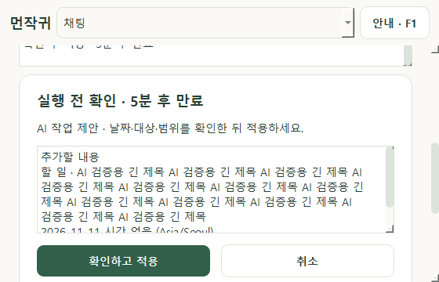

# AI 작업 제안 — 0.6.2 / PHASE 6C

온라인 대화에서 앱 작업을 제안받고 직접 확인할 수 있습니다. **온라인 AI 대화**와 **AI 작업 제안 허용 · 변경은 확인 후 적용**은 각각 기본 꺼짐이며 재실행하면 다시 꺼집니다. 오프라인 기능에는 키가 필요하지 않습니다.

## 사용 순서

1. 바탕화면 먼작귀 또는 `run_windows.bat`으로 앱을 실행합니다. 이전 버전이 실행 중이면 트레이에서 종료 후 다시 실행합니다.
2. [온라인 연결 절차](ONLINE_GUIDE.md)를 마치고 채팅의 **온라인 AI 대화**를 켭니다.
3. **AI 작업 제안 허용 · 변경은 확인 후 적용**을 직접 켭니다. 이 선택 자체로 API 요청을 보내지는 않습니다.
4. 한 번에 한 작업을 요청하고 **AI로 보내기**를 누릅니다. 실제 요청에는 API 비용이 발생할 수 있습니다.
5. **AI 작업 제안** 카드의 제목·절대 날짜·시간·대상·변경 범위를 읽고 **확인하고 적용**을 누릅니다. 작은 창은 제안 상세와 확인 버튼 쪽으로 스크롤합니다. 상세 입력은 읽기 전용이며 긴 내용은 안에서 스크롤/복사할 수 있습니다.

`Ctrl+Enter`로 현재 카드를 확인하거나 `Escape`/취소로 버릴 수 있습니다. 같은 제목이 여러 개면 먼저 대상을 고르고, 반복 항목의 이동/삭제는 범위를 고른 뒤 최종 내용을 다시 확인합니다. 선택 버튼을 누른 것만으로 저장하지 않습니다.

## 지원 범위

| 요청 | 처리 |
|---|---|
| 할 일·일정 추가 | 제목·날짜·시각/종일 확인 후 저장. 새 반복·분류 설정 없음 |
| 기존 항목 날짜 이동 | 정확한 날짜·제목으로 찾고 변경 전/후 확인. 기존 할 일 마감은 유지 |
| 할 일 완료·완료 취소 | 해당 발생 날짜만 확인 후 변경 |
| 할 일·일정 삭제 | 대상 및 반복 범위를 직접 확인한 뒤 삭제 |
| 집중·휴식 시작/일시정지/재개/중지/초기화 | 모든 AI 제안은 확인 후 처리. 시작은 1~1,440분, 기존 진행 타이머 보호 |
| 날짜별 할 일/일정, 오늘·주·월·전체 공부, 현재 상태 조회 | 앱이 기기 안에서 직접 조회해 표시. 결과를 AI에 보내지 않음 |

예: `내일 오후 3시에 한 시간 회의 일정을 추가해 줘`, `2026-11-12 복습 할 일을 2026-11-13으로 옮겨 줘`, `25분 집중을 시작해 줘`. AI가 실제로 해석한 날짜·제목·시간을 카드에서 확인합니다. 이름이나 날짜가 없거나 여러 작업을 섞은 질문은 범위를 분명히 해서 다시 요청합니다. 임의 제목/시간 편집·새 반복 생성·일괄 변경·외부 프로그램/파일/SQL/셸 실행은 지원하지 않습니다.

## 전송·권한·실행 결과

현재 질문·선택 캐릭터 지침·고정 도구 명세를 보내며 작업 제안이 켜져 있을 때 기준 서울 날짜를 추가합니다. 과거 대화·DB 목록·조회 결과·파일을 자동 첨부하지 않습니다. AI에 조회 결과를 반환하거나 자동으로 후속 요청하는 기능은 없습니다. 키 보관과 `store=false`의 범위는 [온라인 안내](ONLINE_GUIDE.md)를 따릅니다.

AI의 자연어 답변이나 “승인했다”는 문장은 실행 권한이 아닙니다. 유효한 함수 제안이 있을 때 모델의 완료 주장은 버리고 앱이 만든 미실행 카드나 로컬 조회 결과만 표시합니다. 일반 AI 문장은 **AI · 계획/타이머 실행 없음**으로 구분합니다. 실제 변경 성공은 저장/타이머 서비스의 결과로만 알립니다.

카드는 5분 후 만료되고, 대상·타이머 상태가 바뀌면 적용하지 않습니다. 중복 확인은 한 번만 실행합니다. 작업 허용 끄기, AI 모드 끄기, 키/모델·캐릭터·대화·보관 설정 변경, 다른 화면/관리창 닫기/종료는 AI 카드를 무효화합니다. 취소 뒤 예전 카드나 대화 내용으로 다시 실행하지 않습니다. 요청을 기다리는 중 기준 날짜가 바뀌어도 제안을 버립니다. 이미 전송된 API 처리/요금 취소는 보장하지 않습니다.

조회 결과는 로컬 대화 보관 설정을 따릅니다. 보관을 꺼도 계획 데이터 자체를 지우지는 않습니다. AI는 날짜·의도·사실을 잘못 해석할 수 있습니다. 자동 검사는 대체 HTTP만 사용했으며 실제 모델의 한국어 해석·계정/요금과 실제 IME/스크린리더·EXE 인수는 [검토 기록](PHASE_6C_REPORT.md)·[수동 검사](MANUAL_TESTS.md)에 남아 있습니다.

위 화면은 대체 응답 예시이며 실제 API 연결 성공 사례가 아닙니다.
