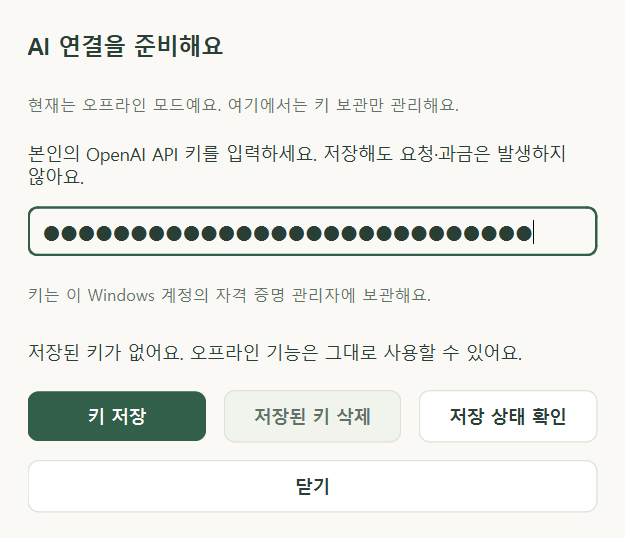

# API 키 관리 — 0.6.0 / PHASE 6A

설정의 **API 키 관리**에서 본인의 OpenAI API 키를 보관할 수 있습니다. 현재는 로컬 보관 단계이며 **연결 테스트·온라인 AI 대화는 아직 없습니다**. 키를 입력하지 않아도 기존 계획·타이머·캐릭터·오프라인 대화는 사용할 수 있습니다.

## 저장·교체·삭제

1. 관리창에서 **설정** 또는 Ctrl+9 → **API 키 관리**를 누릅니다.
2. 본인 키를 입력하고 **키 저장**을 누릅니다. 입력은 마스킹하며 저장된 키를 다시 표시하지 않습니다.
3. 이미 보관한 키가 있으면 교체 여부를 먼저 묻습니다. 기본 선택은 취소입니다.
4. 입력은 저장 시도·교체 취소·창 닫기/숨기기 때 지워지며 undo로 복구하지 않습니다. 실패하면 다시 입력합니다.
5. **저장 상태 확인**은 로컬 저장 여부만 확인합니다. OpenAI에 요청하지 않으며 키의 유효성·계정 권한을 판정하지 않습니다.
6. **저장된 키 삭제**는 확인 후 이 앱의 보관 항목만 제거합니다. 계획·공부 기록·설정은 유지됩니다.

키를 바꾸거나 지우는 데 성공하면 이전 채팅의 실행 전 확인 카드는 무효화합니다. 취소/실패 시 기존 카드를 실행하거나 데이터를 변경하지 않습니다. 진행 중인 집중 시간은 유지됩니다.

입력 검사는 공백 없는 ASCII 문자 16~512자라는 앱의 보관 한도만 확인합니다. 정해진 글자 수나 접두어만으로 실제 API 인증 성공을 보장하지 않습니다. 채팅에 키를 붙여넣으면 저장 전에 차단하고 이 화면을 안내합니다. 탐지가 모든 비밀 문자열을 완벽하게 식별하는 것은 아닙니다.

## 보관 위치와 범위

키는 일반 JSON·SQLite·로그 파일에 쓰지 않고 Windows 자격 증명 관리자의 사용자 항목에 보관합니다. 기본 이름은 `DesktopBuddy/OpenAI/APIKey`입니다. 같은 PC의 같은 Windows 사용자가 다음 로그인에서도 사용할 수 있도록 저장합니다. [Microsoft CREDENTIALW 문서](https://learn.microsoft.com/en-us/windows/win32/api/wincred/ns-wincred-credentialw)

별도 `--data-dir` 개발 폴더는 경로 해시가 포함된 `DesktopBuddy/Development/.../OpenAI/APIKey` 항목을 사용합니다. 테스트는 실제 사용자 키를 읽지 않고 메모리 대체 저장소 또는 고유 `DesktopBuddy/QA/...` 항목의 가짜 값만 사용합니다.

앱 폴더를 교체하거나 사용자 DB를 지우는 것만으로 Windows 보관 항목이 삭제되지는 않습니다. 필요하면 앱의 키 삭제를 먼저 사용합니다. 로컬 삭제는 OpenAI 계정에서 키를 폐기하는 작업이 아닙니다.

같은 Windows 계정 권한으로 실행되는 다른 프로그램의 접근까지 막는 보장은 없습니다. 네이티브 임시 버퍼는 사용 후 지우지만 Python/Qt가 사용하는 모든 메모리 사본의 완전한 삭제를 보장하지 않습니다. 개발자 공용 키는 앱에 내장하지 않았습니다. [OpenAI 공식 인증 안내](https://developers.openai.com/api/reference/overview#authentication)

## 오류가 나면

Windows 저장소를 이용할 수 없으면 일반 파일에 대신 저장하지 않습니다. 이 경우 오프라인 기능을 계속 사용하고 저장 상태를 다시 확인할 수 있습니다. 서비스/제한된 로그인 세션에서는 Windows 자격 증명 API를 사용할 수 없을 수 있습니다. [Microsoft CredWriteW 오류 안내](https://learn.microsoft.com/en-us/windows/win32/api/wincred/nf-wincred-credwritew)

현재 버전은 저장 성공을 연결 성공으로 표시하지 않습니다. 실제 API 요청·연결 테스트·비용 안내·취소는 6B, AI가 제안한 변경의 안전한 확인은 6C 단계입니다. 이번 실행/미검증 범위는 [6A 검토 기록](PHASE_6A_REPORT.md)을 따릅니다.
