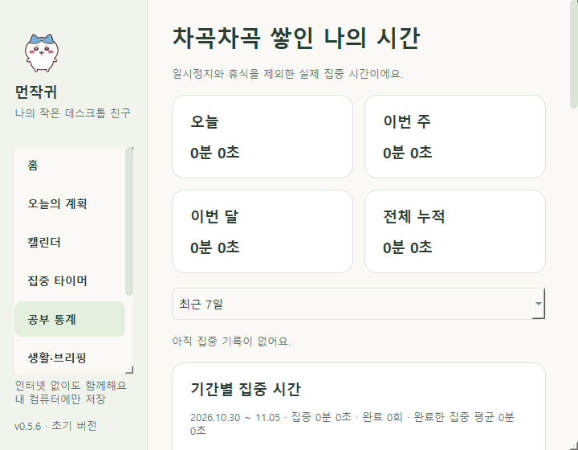
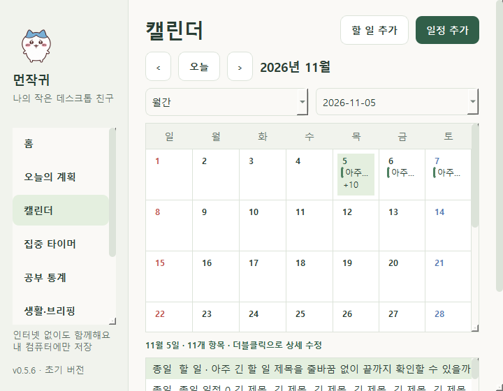
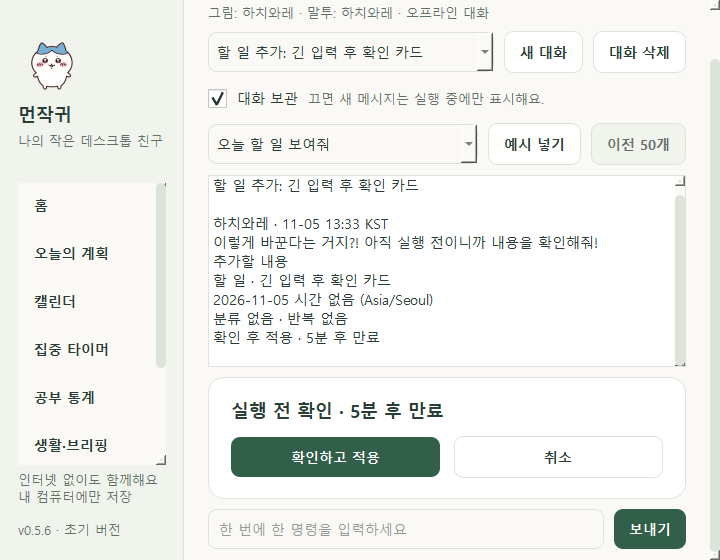

# 0.5.6 UI·안정성 재점검

검증일: 2026-11-05, 한국 시간. 기존 0.5.5의 전체 366개 회귀를 먼저 확인한 뒤 화면과 실패 상황을 추가 점검했습니다. 모든 GUI 검사는 새 임시 DB 또는 전용 `.qa/<검사>/<UUID>` DB를 사용했습니다.

## 재현과 수정

| 문제 | 수정 결과 |
|---|---|
| 긴 카테고리 이름이 집중 설정·편집창의 너비를 밀어 가로 스크롤과 잘림 발생 | 선택 목록의 최소 너비 제한·전체 이름 툴팁, 긴 폼의 줄 배치 허용 |
| 작은 높이에서 계획·캘린더·채팅 하단 조작에 접근하기 어려움 | 세로 스크롤, 720×480 논리 크기 지원, 실제 작업 영역에 창과 제목 표시줄 크기 보정 |
| 최대화한 관리창에서 메뉴를 누르면 일반 창으로 복원 | 최대화 상태를 유지하며 최소화 상태만 해제 |
| 통계의 4개 요약·2개 비교 카드가 작은 창에서 지나치게 좁음 | 가용 너비에 따라 4/2/1열 또는 2/1열 배치, 기록 분류와 버튼을 별도 줄에 배치 |
| 월간 셀 높이 부족으로 날짜·더 보기 버튼 잘림 | 행의 최소 높이와 내부 스크롤, 긴 항목 말줄임표, 오늘 표시와 전체 제목 툴팁 |
| 주간 머리글·긴 종일 제목이 전체 페이지를 넓히고 세 번째 더 보기 높이 초과 | 날짜/요일 두 줄, 줄어들 수 있는 항목 버튼, 더 보기 높이 제한 |
| 30개가 겹치는 주간 일정에서 최소 8px 블록이 옆 칸을 침범 | 실제 할당된 열 너비 안에서 블록 너비 계산 |
| 통계 기간 변경·앞쪽 휴식 기간 추가 시 행 번호가 다른 항목을 가리킴 | 기록 ID로 선택 보존, 기존 대상이 없으면 선택 해제 |
| 집중·생활 설정 저장 실패 때 체크 표시가 저장값과 달라짐 | 모든 관련 화면을 실제 설정으로 복원, 종료 중 저장 실패로 창 재표시 방지 |
| 제목·메모의 마크업이 툴팁에서 서식으로 해석될 수 있음 | 문자로 이스케이프하고 제목과 메모를 함께 확인 |
| 작은 채팅창에서 확인 카드가 나타나면 입력칸이 아래로 밀림 | 카드 배치 이후 입력칸까지 자동 스크롤, 확인 버튼도 접근 가능한지 회귀 검사 |

작업 영역과 DPI 신호에서 관리창 위치를 보정합니다. 실제 모니터 제거·혼합 배율 이동은 별도 수동 확인 대상입니다. 제목·경로·대화 원문과 캐릭터별 말투 규칙은 변경하지 않았습니다.

## 검증 결과

- pytest 전체 **380개 통과**: 기존 366개와 새 재현 검사 14개.
- 새 검사에는 밝은/어두운 9페이지의 720×480·720×560 배치, 긴 분류, 편집 저장, 최대화/최소화 복원, 저장 실패, 통계/휴식 선택, 30개 겹침, 종일 더 보기, 문자 툴팁을 포함합니다.
- Qt 한글 조합·커밋 이벤트는 Enter 전에 명령을 실행하지 않으며, Enter로 확인 카드를 만들고 Space로 확인할 때 한 번 저장되는지 검사했습니다. 실제 Windows IME 엔진을 조작한 검사는 아닙니다.
- Windows Qt 기능 자체 검사 **53개 통과**: 계획·집중·통계·3종 선택/말투·시선/이동·완료 음악의 무음 대역·종료/복구.
- Windows Qt UI 검사: 유효 DPR **1.0·1.25·1.5·2.0**, 각각 **29개 화면 상태**, 합계 **116개**. 페이지 가로 넘침·버튼 너비·줄바꿈 라벨 높이·직접 자식 위젯 겹침 검출 **0건**. 이는 정해진 위젯/상태 검사이며 모든 픽셀과 상황의 오류 부재를 보장하지 않습니다.
- 밝은/어두운 화면과 작은 창을 앱 위젯 캡처로 검토했습니다. 다른 앱이나 사용자 바탕화면은 캡처하지 않았습니다.
- ruff 검사·포맷 확인, 0.5.6 one-folder 빌드와 제품 버전·고정 에셋 포함 확인.

DB 스키마 6을 유지했습니다. 사용자 DB·로그·사진 원본은 검사 또는 배포에 넣지 않습니다. 실제 사용자 사진 27개는 작업 폴더에 보존합니다.







## 재실행과 수동 확인

트레이에서 **프로그램 종료 → 바탕화면 먼작귀 실행**으로 업데이트된 소스를 불러옵니다. 현재 실행 중인 사용자 앱을 검사 도중 강제 종료하지 않았습니다.

다음 순서로 직접 확인할 수 있습니다.

1. 관리창을 작게 줄여 각 메뉴와 맨 아래 버튼까지 세로 스크롤합니다.
2. 긴 카테고리 이름을 선택하고 할 일·일정 편집의 저장/취소를 확인합니다.
3. 관리창 최대화 후 메뉴를 옮겨 창 크기가 유지되는지 확인합니다.
4. 채팅에서 한글 명령을 입력하고 확인 카드를 키보드로 적용합니다.

실제 Windows 한글 IME·스크린리더·혼합 DPI 모니터 이동·OS 트레이/알림·음악 출력 장치·절전/복귀·Windows 10·깨끗한 PC의 EXE 실행·장시간/대규모 데이터 성능은 [수동 목록](MANUAL_TESTS.md)에 남았습니다. EXE 빌드는 실행 검증을 대신하지 않습니다. 이전 앱 제어 차단을 우회하지 않았습니다.

## 재현 도구와 주요 파일

```powershell
.venv\Scripts\python.exe -m pytest -q
.venv\Scripts\python.exe -m ruff check .
.venv\Scripts\python.exe -m ruff format --check .
$env:QT_QPA_PLATFORM='windows'
.venv\Scripts\python.exe tools\ui_smoke.py current
.venv\Scripts\python.exe tools\native_smoke.py
```

`tools/ui_smoke.py`는 `.qa/ui-audit-<태그>/report.json`과 화면을 생성합니다. `QT_SCALE_FACTOR`는 현재 OS 배율에 곱하므로 결과의 `dpr`을 확인해야 합니다. 이번 PC의 기본 DPR은 2.0이었고 배율 인자 0.5/0.625/0.75/1.0으로 유효 100/125/150/200%를 검사했습니다. 시스템 배율 설정은 바꾸지 않았습니다.

UI 공통 도구는 `src/desktop_buddy/ui/common.py`, 화면별 수정은 같은 폴더의 관리창·채팅·계획·캘린더·통계·생활·편집 모듈, 재현 검사는 `tests/test_ui_audit.py`에 있습니다. 다음 검증은 실제 입력과 장치 이동, 절전·배포 실행입니다.
