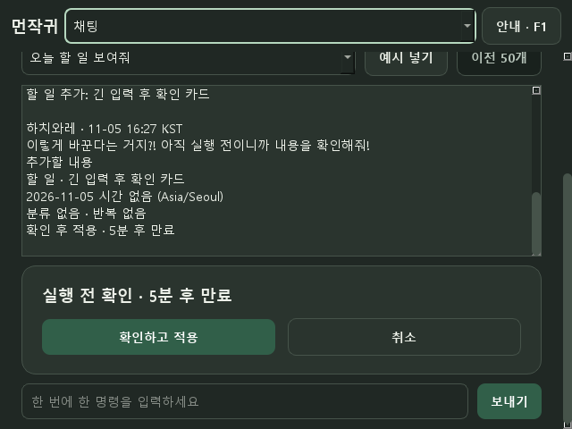

# 작은 창·로컬 패키징 재검토 — 0.5.8

최종 검토일: 2026-11-10, 한국 시간. 중단된 작은 창·패키징 작업을 이어서 코드와 테스트를 검토하고, EXE 시작 오류를 재현해 빌드 구성을 수정했습니다. 실제 사용자 DB·원본 사진 27개는 수정하거나 테스트에 사용하지 않았습니다. DB 스키마는 6을 유지합니다.

## 구현과 수정

- 관리창 최소 크기 560×360, 너비 800 논리 픽셀 미만은 상단 화면 선택 메뉴를 사용합니다. 기존 9개 화면·단축키·F1 안내를 공유합니다.
- 크기 변경 때 숨겨지는 메뉴의 초점을 표시되는 메뉴로 옮깁니다. 채팅 초안·확인 카드·진행 타이머는 초기화하지 않습니다.
- 빌드 뒤 로컬 ZIP·사용법·파일별 해시 목록·ZIP 체크섬을 생성합니다. EXE 제품 이름/버전·고정 에셋 원본 일치·필수 Windows 파일을 확인합니다. 사용자 데이터·링크·작업 원본·추가 에셋·경로 침범·목록/해시 불일치는 거부합니다.
- ZIP 쓰기가 실패하면 임시 ZIP을 정리하고 기존 ZIP을 보존합니다. 업로드·자동 업데이트·서버 기능은 추가하지 않았습니다.

## 재현한 QtGui 시작 오류

임시 `.qa` 데이터 경로와 offscreen 플랫폼, 숨긴 창, 10초 제한을 둔 EXE 검사에서 `DLL load failed while importing QtGui: 지정된 프로시저를 찾을 수 없습니다`를 재현했습니다. 사용자 DB를 열기 전 실패했습니다. 이 검사에서 만든 프로세스만 종료했습니다.

번들 Qt DLL은 설치된 PySide6와 같았으나, PyInstaller가 개발자 PATH에 있던 별도 문서 도구의 `icuuc.dll`과 `icudt78.dll`을 가져왔습니다. 해당 ICU는 Qt6Core가 요구한 Windows ICU 심볼 20개를 제공하지 않았습니다. 소스 실행에서는 Windows System32의 ICU를 사용했습니다.

`tools/build_runtime.py`와 spec에서 **빌드 프로세스의 PATH만** Python·PySide6·Windows 디렉터리로 제한했습니다. 시스템 ICU는 앱 폴더에 복사하지 않으며 다른 위치의 ICU가 분석되면 빌드를 중단합니다. 패키지 검사도 앱 폴더의 ICU 복사본을 거부합니다. 시스템/사용자의 영구 PATH나 보안 정책은 변경하지 않았습니다.

수정 후 빌드에서 앱 내부 ICU 파일이 없고, 현재 Windows System32 ICU가 Qt의 요구 심볼 20개를 모두 제공함을 정적으로 확인했습니다. 다시 실행하려 했으나 Windows가 **“애플리케이션 제어 정책에서 이 파일을 차단했습니다”**라고 반환했습니다. 따라서 DLL 구성 수정과 빌드/패키지 검증은 완료했으나, **수정 후 EXE 실행 성공은 미검증**입니다. 보안 설정 변경이나 대체 로더를 통한 우회는 하지 않았습니다.

## 검증 결과

| 검사 | 결과와 범위 |
|---|---|
| 전체 pytest | 437개 통과, 임시 DB·Qt offscreen |
| 신규 회귀 | 작은 창 7개·ZIP 23개·빌드 경로 3개 |
| Ruff | check·format check 통과 |
| 화면 자동 검사 | 5조건 × 31상태 = 155개, 겹침/잘림/부모 밖 침범 0건 |
| EXE 빌드 | PyInstaller 0.5.8 one-folder 생성, 제품 이름/버전·고정 에셋 검증 |
| ICU 정적 검사 | 앱 내부 ICU 0개, 요구 Windows 심볼 20개 누락 없음 |
| ZIP | 파일 목록 867개와 크기/해시 검증 통과, ZIP 73,575,828바이트 |
| EXE 실제 실행 | 수정 후 Windows 앱 제어 정책 차단, 미검증 |

화면 검사는 11월 5~10일 `.qa/ui-audit-release-small`, `release-compact`, `release-wide`, `release-dpi125`, `release-dpi150`에서 수행했습니다. 560×360·640×480·960×760의 합성 창과 offscreen 1.25/1.5배율을 사용했습니다. 기본 가상 화면 작업 영역 때문에 배율 조건의 실제 논리 너비는 약 636/529이며, 개별 대화상자는 자체 크기 보정을 따릅니다. 960×760 조건은 가상 작업 영역 제한을 해제한 검사입니다. 각 `report.json`에 실제 크기·DPR·검사 결과를 기록했습니다. 주/일 달력도 요청한 넓은 크기로 재검사했습니다. 실제 모니터 배율 전환이나 OS 입력 검증은 아닙니다.

작은 집중 화면·어두운 채팅 확인 화면과 넓은 메뉴 화면의 이미지를 확인했습니다. 스크린샷은 전용 QA 데이터의 위젯 렌더이며 실제 사용자 화면을 캡처하지 않았습니다.




이 빌드 ZIP의 SHA-256:

```text
8d230abfa066052b93626405b0c24dcce0b602b2261abff074b68876edb0701d
```

해시 검증은 전자 서명/배포 신뢰성이나 실제 실행 검증을 대신하지 않습니다. 재생성한 ZIP은 체크섬이 바뀔 수 있습니다. 빌드/검증 명령은 [배포 후보 안내](RELEASE_GUIDE.md)를 따릅니다.

## 주요 파일과 남은 확인

UI는 `src/desktop_buddy/ui/management.py`, 빌드는 `DesktopBuddy.spec`·`tools/build_runtime.py`, 패키징은 `tools/package_release.py`·`build_windows.bat`입니다. 관련 회귀는 `tests/test_compact_navigation.py`·`test_release_package.py`·`test_build_runtime.py`입니다.

현재 PC에서는 기존 바탕화면 먼작귀 또는 `run_windows.bat` 소스 실행을 사용합니다. 업데이트 적용은 트레이에서 종료한 뒤 재실행합니다. 실제 Windows IME·스크린리더·OS 트레이/토스트·음악 청취·절전·혼합 DPI·Windows 10·깨끗한 PC의 EXE 인수는 [수동 목록](MANUAL_TESTS.md)에 남겼습니다.

다음은 장치 검증 결과와 오류 제보를 반영하는 작업입니다. 후속 요청에 따른 PHASE 6 AI 연결은 별도 구현 범위이며 현재 자유 AI 대화·API 키 입력은 제공하지 않습니다.
