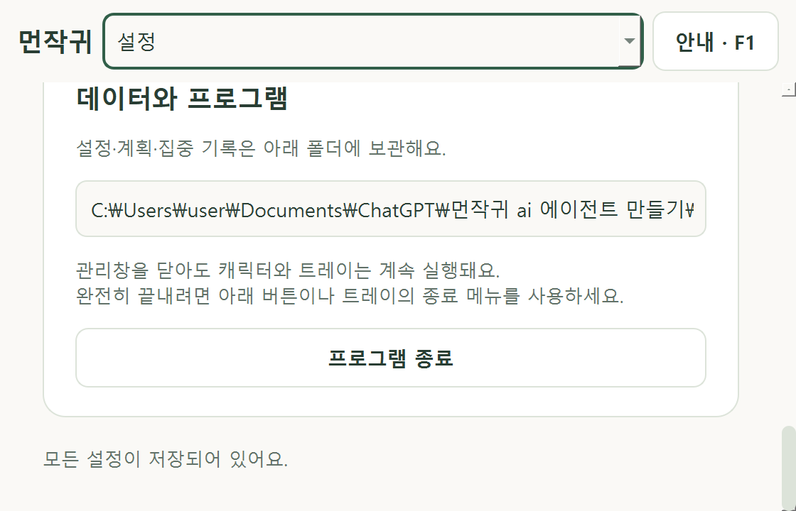

# Windows Qt 검증·긴 경로 수정 — 0.5.9

검증일: 2026-11-10, 한국 시간. 0.5.8 이후 Windows Qt 키보드·작은 창·배율 검사를 진행하고, 긴 데이터 경로가 설정 화면을 가로로 넓히던 오류를 수정했습니다. 실제 사용자 DB·원본 사진·Windows 보안/배율 설정은 변경하지 않았습니다. DB 스키마는 6입니다.

## 재현과 수정

Windows Qt에서 기존 키보드/작은 창 31개를 실행했을 때 29개가 통과하고, 560×360 설정 화면의 밝은/어두운 테마 2개가 실패했습니다. 긴 QA 데이터 폴더 경로가 표시된 페이지에 가로 스크롤 범위 43이 생겼습니다. 해당 pytest 창은 Windows 기본 스타일을 사용하며, 실제 앱과 UI 검사기는 Fusion 스타일을 사용합니다.

경로 길이의 영향을 따로 확인하기 위해 긴 한국어 폴더 경로를 표시하는 회귀를 추가했습니다. 수정 전 offscreen에서도 두 테마 모두 가로 스크롤 범위 122로 실패해 경로 표시의 문제를 재현했습니다. 경로 문자열만 QA 위젯에 넣었으며 그 위치의 실제 폴더나 사용자 데이터는 읽지 않았습니다.

`src/desktop_buddy/ui/management.py`에서 경로 QLabel을 **읽기 전용 QLineEdit**로 바꿨습니다. 긴 텍스트는 입력칸 안에서 확인하며 전체 경로 원문을 유지합니다. Tab 초점·Ctrl+A 전체 선택·Ctrl+C 복사를 지원하고 접근성 이름/설명을 제공합니다. 폴더 이동이나 저장 위치 변경 기능은 추가하지 않았습니다. 회귀에서 읽기 전용·전체 선택·입력으로 경로를 바꾸지 못함을 확인했고 시스템 클립보드는 변경하지 않았습니다.

`tools/native_smoke.py`는 종료 뒤 체크포인트·잠금/타이머 정리 검사 중 False가 있으면 종료 코드도 실패하도록 보강했습니다. `tools/ui_smoke.py`의 보고서는 플랫폼·실제 DPR과 함께 구성한 스타일을 기록합니다.

## 실행 결과

| 검사 | 결과 |
|---|---|
| 전체 pytest | 439개 통과, 새 QA 데이터·Qt offscreen |
| Windows Qt 키보드/접근성/작은 창 | 수정 후 33개 통과, Qt API 입력과 접근성 인터페이스 검사 |
| Windows Qt 수명주기 | 53개 bool 검사 모두 True, 실패 목록 없음·종료 코드 0 |
| Windows Qt 화면 배치 | 5조건 × 31상태 = 155개, 자동 검사의 겹침/잘림/부모 밖 침범 0건 |
| Ruff | check·format check 통과 |
| PyInstaller/ZIP | 0.5.9 one-folder 빌드, 제품 이름/버전·고정 에셋 검증·파일 목록 867개와 ZIP SHA-256 검증 통과 |
| 실제 OS 키 입력/IME | QA 창을 자동화 도구에서 선택하지 못해 수행하지 않음 |
| 실제 EXE | 미검증, 이전 앱 제어 정책 차단을 우회하거나 보안 설정을 바꾸지 않음 |

키보드/접근성 검사는 `tests/test_keyboard_accessibility.py`·`tests/test_compact_navigation.py`를 `QT_QPA_PLATFORM=windows`로 실행했습니다. 기존 24개와 작은 창/경로 9개이며 전체 439개와 별개의 플랫폼 재실행입니다. 실제 OS SendInput·한국어 IME 조합·스크린리더 음성 인수는 아닙니다.

화면 검사는 실제 Qt Windows 플랫폼과 Fusion에서 다음 조건으로 실행했습니다. 현재 화면의 기본 DPR 2.0에 검증 프로세스의 `QT_SCALE_FACTOR`만 곱해 보고서의 실제 DPR을 확인했습니다. Windows 디스플레이 설정은 변경하지 않았습니다. 각 상태는 밝음/어둠 9개 화면·월/주/일·채팅 확인·키보드 안내·편집/선택 등이며, 대화상자는 자체 크기 보정을 따릅니다.

| QA 태그 | 실제 DPR | 관리창 요청 크기 | 상태 수 |
|---|---|---|---|
| win059-100 | 1.0 | 560×360 | 31 |
| win059-125 | 1.25 | 560×360 | 31 |
| win059-150 | 1.5 | 560×360 | 31 |
| win059-200 | 2.0 | 560×360 | 31 |
| win059-wide | 2.0 | 960×760 | 31 |

`.qa/ui-audit-<태그>/report.json`과 위젯 렌더를 생성했습니다. 작은 설정 화면 아래의 경로 입력칸과 어두운 테마 이미지를 확인했습니다. 물리 모니터 간 이동·실시간 배율 변경·절전/복귀를 수행한 검사는 아닙니다. 수명주기 검사에서 소리는 대체 백엔드를 사용했으며 실제 음악 청취를 인수하지 않았습니다.



이번 ZIP은 73,576,445바이트이며 SHA-256은 다음과 같습니다. 재빌드하면 달라질 수 있으므로 같은 빌드의 체크섬과 비교합니다.

```text
f8175dccbe1e192e3575b0d03059c681f7081b0ae0937e5071ff0cb8117eede0
```

## 실제 Windows 입력 확인의 한계

Computer Use 도구를 초기화하고 임시 DB의 QA 앱을 실행했으나 창 목록에서 해당 창을 찾지 못했습니다. 별도 시작 방식으로 재실행한 뒤에도 같아 OS 키 입력은 보내지 않았습니다. 기존 0.5.7의 사용자 입력 감지 중단과는 다른 상황입니다. 이번 결과를 IME·스크린리더 실사용 통과로 표시하지 않습니다. QA 실행기는 20분 자동 종료 제한이 있습니다.

EXE는 이전 0.5.8 실행에서 Windows 앱 제어 정책에 막혔습니다. 이번 0.5.9 빌드·패키지와 소스의 Windows Qt 검사는 이를 대체하지 않습니다. 보안 설정 변경이나 대체 로더 실행은 하지 않았습니다.

## 실행과 다음 단계

트레이의 **프로그램 종료 → 바탕화면 먼작귀**로 새 버전을 불러옵니다. 또는 `run_windows.bat`을 실행합니다. 설정 아래 데이터 폴더에 Tab으로 이동해 전체 경로를 선택할 수 있습니다. 주요 변경은 관리창·작은 창 회귀와 두 QA 도구이며, 빌드/ZIP 방법은 [배포 후보 안내](RELEASE_GUIDE.md)를 따릅니다.

실제 IME·스크린리더·모니터/절전·Windows 10·깨끗한 PC EXE는 [수동 목록](MANUAL_TESTS.md)에 남겼습니다. 다음 기능 구현은 후속 요청에 따라 PHASE 6A의 Windows 보안 저장소 키 관리부터 진행할 수 있습니다. 현재 AI/API 연결은 추가하지 않았습니다.
