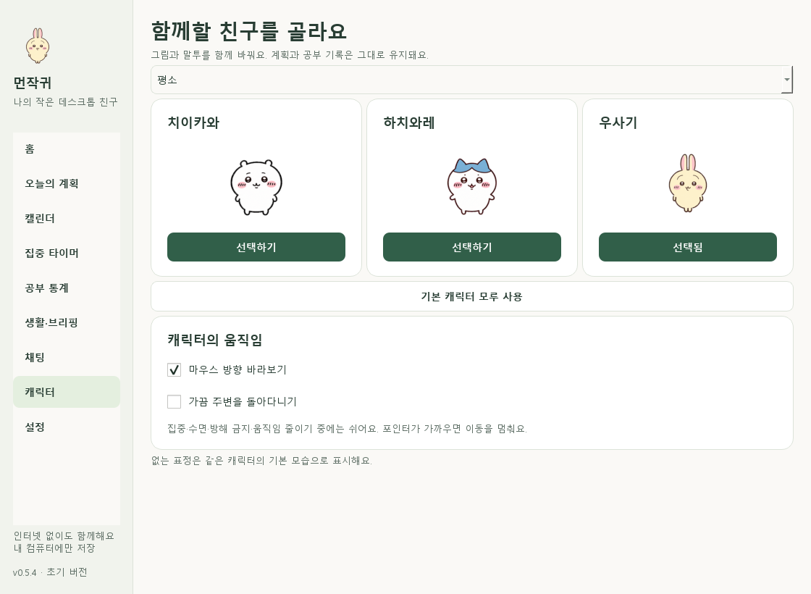
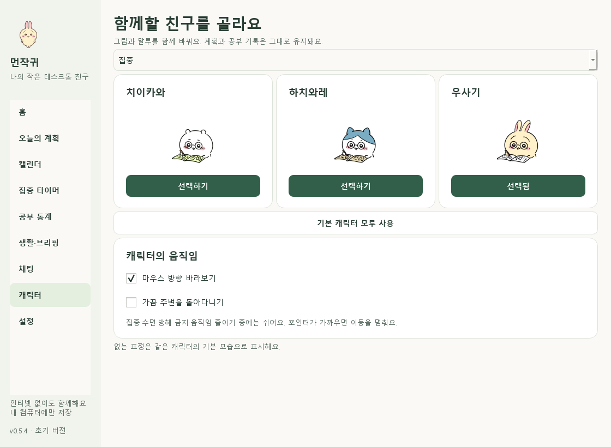
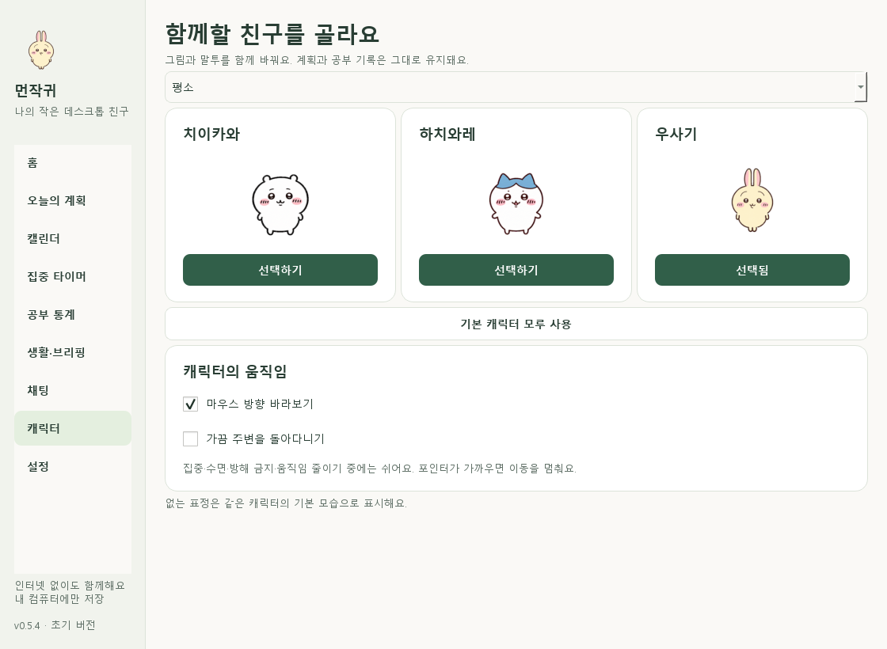

# 캐릭터 선택과 이미지 팩 — 0.5.4

첫 설치에서 **치이카와·하치와레·우사기** 중 함께할 캐릭터를 고릅니다. 실제 그림과 대화 말투가 함께 바뀌며 재시작해도 유지합니다. 나중에 선택하면 기본 모루로 사용할 수 있고 다음 실행에 다시 안내합니다. 기존 사용자의 설정과 데이터는 보존합니다.

관리창 **캐릭터** 또는 채팅 오른쪽 위 목록에서 언제든 변경합니다. 기본 이름은 선택한 캐릭터를 따르며 직접 정한 별명은 유지합니다. 계획·공부 기록·진행 타이머·위치·직접 숨김·과거 대화 화자는 바뀌지 않습니다. 새 캐릭터는 개발자가 앱 업데이트로 추가합니다.



## 현재 연결한 모습

| 상황 | 표시와 재생 |
|---|---|
| 평소 | 6프레임 반복 |
| 클릭 인사 | 4프레임 반응 뒤 현재 상태 복귀 |
| 집중 | 공부하는 3프레임 반복 |
| 휴식 | 6프레임 반복 |
| 집중·휴식 완료 | 5프레임 반응 뒤 현재 상태 복귀 |
| 공부 공백으로 시무룩 | 8프레임 반복 |
| 걱정·수면 | 같은 캐릭터의 평소 모습 사용 |
| 오른쪽·왼쪽 달리기 | 방향별 8프레임, 자동 이동 중 재생 |
| 마우스 방향 바라보기 | 16방향 중 현재 포인터 방향에 해당하는 정지 포즈 |

걱정·수면의 별도 그림은 아직 없습니다. 생활 규칙·조용한 시간·상태 우선순위는 그대로 적용합니다. 움직임 줄이기를 켜면 정지 프레임으로 표시하며 숨기면 재생을 멈춥니다. 상태 미리보기는 첫 프레임을 보여줍니다.



## 마우스 시선과 돌아다니기

관리창 **캐릭터 → 캐릭터의 움직임**에서 설정합니다. 치이카와·하치와레·우사기에서 사용할 수 있습니다. 모루는 해당 프레임이 없어 옵션을 비활성화하고 안내합니다.

- **마우스 방향 바라보기:** 기본 켜짐. 가까운 포인터 방향을 16방향으로 표현하며 아주 가까이 있거나 멀리 떨어지면 평소 모습으로 돌아갑니다. 경계에서 포즈가 자주 바뀌지 않게 완화했습니다. 포인터 위치를 저장하거나 전송하지 않습니다.
- **가끔 주변을 돌아다니기:** 기본 꺼짐. 켜면 평소 상태에서 18~35초 기다린 뒤 현재 모니터 작업 영역 안에서 짧게 좌우 이동합니다. 높이는 유지하며 다른 모니터나 작업 표시줄 영역으로 이동하지 않습니다.
- **직접 조작 우선:** 포인터가 가까워지거나 드래그/우클릭 메뉴를 열면 이동을 멈춥니다. 관리창·첫 선택 화면·말풍선을 보는 동안에도 자동 이동을 미룹니다. 클릭 인사가 끝나면 시선 기능을 다시 적용합니다.
- **조용한 상태:** 집중·타이머 일시정지·수면·방해 금지·숨김·움직임 줄이기 중에는 시선/이동을 멈춥니다. 기존 공부 공백 표정도 우선합니다.
- **위치와 복구:** 이동이 끝나거나 중단될 때 현재 위치를 저장하며 매 프레임 저장하지 않습니다. 긴 응답 공백·수동 재배치·캐릭터 변경 뒤에는 이전 이동 경로를 폐기합니다. 작은 타이머도 캐릭터를 따라갑니다.



## 이후 사진을 추가·교체할 위치

작업 원본은 `assets/characters/<id>/<상태>/`에 둡니다. 기존 PNG·GIF는 그대로 보존하며 이 폴더를 앱이 자동으로 검색하거나 배포하지 않습니다. 그림을 정한 뒤 실행 팩을 갱신하고 검사합니다. 권장 형식·상태별 예시는 [원본 준비 안내](../assets/characters/README.md)를 따릅니다.

현재 실행 팩은 `assets/character_packs/chiikawa`, `hachiware`, `usagi`이며 각 폴더에 `manifest.json`, `atlas.png`, `focus_001.png`~`focus_003.png`가 있습니다.

개별 PNG 목록 또는 아틀라스 셀 좌표를 `states.<상태>.frames`에 적고 `fps/loop`와 선택형 `durations_ms`로 재생을 정합니다. `idle`은 필수이며 없는 상태는 `aliases`로 같은 팩의 기본 모습에 연결합니다. 다음은 한 프레임의 최소 예시입니다.

```json
{
  "id": "chiikawa",
  "atlas": {"path": "atlas.png", "cell_width": 192, "cell_height": 208},
  "states": {
    "idle": {
      "frames": [{"row": 0, "column": 0}],
      "fps": 3,
      "loop": true,
      "durations_ms": [280]
    }
  },
  "aliases": {"worried": "idle", "sleep": "idle"}
}
```

팩은 다음 제한을 통과해야 합니다.

- manifest 64 KiB 이하, 고정 ID 일치, 팩 폴더 안의 PNG 경로만 사용.
- 파일 한 장 8 MiB 이하, 개별 PNG 1,024px 이하, 아틀라스 4,096px·4,194,304픽셀 이하.
- 전체 64프레임·디코딩 예산 64 MiB. 손상·빈 프레임·범위 밖 좌표 거부.
- 프레임별 지연 33~5,000ms, 프레임 수와 일치. 런타임 프레임은 256×256.
- `look`은 북쪽부터 시계 방향의 16프레임과 `manual: true`를 사용합니다. 이 클립은 자동 순환하지 않고 방향에 맞는 프레임을 선택합니다. `run_right`·`run_left`는 반복 클립입니다.
- 새 클립·크기 캐시·실루엣 마스크 준비와 설정 저장 성공 후 교체. 실패하면 이전 팩 유지.

PyInstaller는 고정 세 폴더의 5파일씩만 포함합니다. 새 종류나 파일 이름을 추가하면 카탈로그·선택 목록·빌드 구성을 함께 갱신하고 기존 데이터·타이머 유지 검사를 실행합니다.

## 빠른 집중과 작은 타이머

집중 화면의 **15·25·30·60분**은 시간을 채우는 버튼입니다. 펫 우클릭 **집중 바로 시작**은 해당 시간으로 시작하며 진행·일시정지 중에는 비활성화합니다. 같은 메뉴에서 일시정지·재개·중지를 할 수 있습니다.

집중 화면 아래 **작은 타이머 모양**에서 막대형/원형 진행을 고릅니다. 원형은 실제 남은 시간·진행량·일시정지를 표시하고 마우스 입력을 통과시킵니다. 기존 절전·재시작 복구와 공부 기록 계산을 공유합니다.
