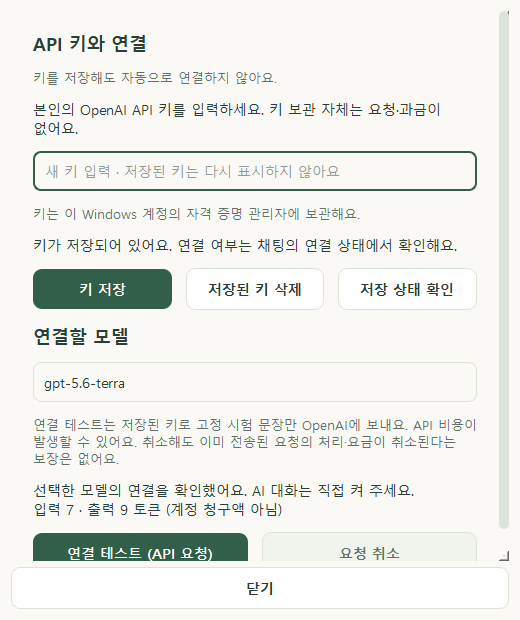
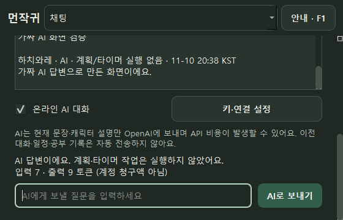

# AI 대화 사용법 — 0.6.1 / PHASE 6B

기본 모드는 오프라인입니다. 본인의 OpenAI API 키가 있고 직접 연결을 선택하면 자유로운 텍스트 질문을 보낼 수 있습니다. **연결 테스트와 AI 전송은 비용이 발생할 수 있습니다.** 앱을 다시 실행하면 AI 대화는 꺼집니다.

## 처음 연결하기

1. 실행 중이었다면 트레이에서 **프로그램 종료** 후 바탕화면 **먼작귀** 또는 `run_windows.bat`으로 다시 실행합니다. 소스 환경에 새 의존성이 없으면 `setup_windows.bat`을 먼저 실행합니다.
2. **설정 → API 키·연결 관리** 또는 **채팅 → 키·연결 설정**을 엽니다.
3. 본인 키를 입력해 **키 저장**을 누릅니다. Windows 자격 증명 관리자에 보관하며 저장 자체는 네트워크 요청이 아닙니다. [키 보관 안내](API_KEY_GUIDE.md).
4. 모델 ID를 확인하고 **연결 테스트 (API 요청)**를 직접 누릅니다. 기본값은 `gpt-5.6-terra`이며 계정에서 사용할 수 있는 모델 ID로 바꿀 수 있습니다. 모델 존재만으로 본인 계정의 사용 권한을 보장하지 않습니다. [기본 모델 공식 문서](https://developers.openai.com/api/docs/models/gpt-5.6-terra).
5. 테스트 성공 후 닫고 채팅의 **AI 대화**를 켭니다. 질문을 입력하고 **AI로 보내기**를 누릅니다. 키나 모델을 바꾸면 다시 테스트해야 합니다.

테스트는 고정된 짧은 시험 문장만 보냅니다. 입력 중인 미저장 키를 테스트에 사용하지 않으며 먼저 저장하도록 안내합니다. 모델 변경은 연결 테스트를 누를 때 저장합니다. 모델 입력칸에 키를 넣지 마세요. 키는 이 채팅이나 앱의 대화 입력에도 붙여넣지 않습니다.

## 무엇을 보내고 저장하는가

| 항목 | 처리 |
|---|---|
| 현재 보내는 문장 | OpenAI로 전송 |
| 선택 캐릭터 | 고정된 말투·정보 보존 지침 전송 |
| API 키 | 고정 HTTPS API 요청의 인증에만 사용 |
| 과거 대화·계획·공부 기록·파일·포인터 | 자동 첨부하지 않음 |
| 모델 ID | 비밀이 아닌 설정으로 로컬 저장 |
| 대화 보관 켜짐 | 사용자 문장과 받은 답변을 기존 대화 DB에 저장 |
| 대화 보관 꺼짐 | 새 메시지를 실행 중 메모리에만 유지 |

현재 요청마다 독립적으로 답합니다. 과거 답변을 이어서 이해하도록 자동 전송하는 기능은 없습니다. 필요한 설명은 현재 질문에 직접 넣습니다. 사용자가 질문에 적은 정보는 전송되므로 개인정보·비밀 값을 넣지 않습니다. 대화 삭제는 로컬 보관을 삭제하며 이미 보낸 정보의 원격 삭제를 의미하지 않습니다.

Responses API에 `store: false`를 지정하고 서버 대화 ID를 사용하지 않습니다. 이 옵션을 모든 원격 보관이 없다는 뜻으로 해석하면 안 됩니다. 응답 상태 보관과 abuse monitoring 등은 별개입니다. [OpenAI 데이터 제어 문서](https://developers.openai.com/api/docs/guides/your-data).

## 대화와 앱 작업

선택 캐릭터의 말투 지침으로 답하며 우사기는 **감탄사 + (실제 내용)**으로 표시합니다. 코드·경로·시각 본문을 말투로 치환하지 않습니다. AI는 틀릴 수 있으며 온라인 답변의 정확성·장기 말투 일관성은 실제 모델 인수가 남아 있습니다.

**현재 AI 응답은 텍스트 대화만 제공합니다.** 답변이 “저장했어”라고 표현해도 계획·타이머가 실행된 것은 아닙니다. 답변 위에 **AI · 계획/타이머 실행 없음**을 표시합니다. `할 일 추가: 복습` 같은 실제 앱 명령은 **AI 대화**를 끄고 기존 확인 카드로 처리합니다. AI 작업 제안/승인은 6C 후속 범위입니다.

## 취소·오류·사용량

- 한 번에 한 요청만 진행합니다. **AI 요청 취소**, 입력 조합 중이 아닌 **Escape**, AI 끄기, 다른 화면/대화/캐릭터로 이동, 관리창 닫기는 대기 요청을 취소하고 늦은 결과를 반영하지 않습니다.
- 이미 전송된 요청의 처리나 비용까지 취소된다는 보장은 없습니다. 취소 후 곧바로 다시 보내면 별도 요청 비용이 생길 수 있습니다.
- 앱은 자동 재시도·오프라인 명령 자동 대체를 하지 않습니다. 실패/취소 시 입력을 남겨 직접 수정하거나 다시 보낼 수 있습니다. 비밀 값 탐지 실패에서는 입력을 지웁니다.
- 최대 대기 시간은 60초입니다. 인증·권한·모델·요청 한도/잔액·연결·시간 초과를 구분해 안내합니다. 실패해도 계획·타이머를 사용할 수 있습니다.
- 반환된 입력/출력 토큰만 표시하며 누락은 **확인 불가**로 표시합니다. 토큰은 계정 청구액이 아닙니다. 앱은 실제 가격이나 잔액을 계산하지 않습니다.

위 화면은 전용 QA 데이터와 대체 응답으로 만들었습니다. 실제 API 연결 성공 사례가 아닙니다. 회귀·빌드 검증과 남은 실제 계정 검사는 [6B 검토 기록](PHASE_6B_REPORT.md)에 구분했습니다.
