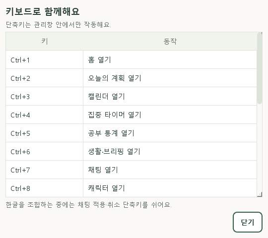

# PHASE 5C 키보드·접근성 — 0.5.7

검증일: 2026-11-05, 한국 시간. 0.5.6 UI 재점검 이후 키보드 이동·확인·조합 보호와 접근성 정보를 보완했습니다. 5C의 구현·자동 검증 결과이며 실제 Windows IME와 스크린리더까지 모두 인수했다는 뜻은 아닙니다.

## 구현

- 관리창의 Ctrl+1~9 메뉴 이동과 주요 입력 초점, Ctrl+L 채팅 입력, F1 안내 및 안내를 닫은 뒤 이전 초점 복원.
- 실제 16개 항목이 있는 키보드 안내와 사이드바 버튼. 작은 창에서 안내 목록을 스크롤하며 읽을 수 있습니다.
- 채팅 Ctrl+Enter 적용, Escape 취소. 대상 선택과 최종 저장을 분리하며 기존 만료·중복·대상 재검증 서비스를 그대로 사용합니다. 단축키 자동 반복은 꺼서 길게 누른 키가 다음 카드까지 실행하지 않도록 합니다.
- 편집 대화상자 뒤의 단축키 차단, 미전송 초안과 진행 중 타이머 보존.
- 한글 preedit 상태에서 보내기·적용·취소 방지. 조합 커밋 또는 입력 초점 이탈 시 보호 상태 해제. 조합 텍스트를 별도 저장하지 않습니다.
- 입력·목록·그래프·타이머의 접근성 이름/설명, 확인 카드·오류·타이머 상태 변경 안내 이벤트. 숨긴 화면과 타이머 매 틱 안내 제외.

## 검증

- 새 회귀 **24개 통과**: 9개 메뉴 단축키, 초안/타이머 유지, 중복/취소, 선택 후 최종 확인, 키 자동 반복, 만료, 3종 조합 중 키, 조합 종료, 모달, 안내 복귀, 진행/일시정지 버튼 초점, 접근성 인터페이스 이름, 안내 횟수/가시성, 작은 창 Tab/Shift+Tab.
- 전체 pytest **404개 통과**, ruff 검사와 포맷 확인 통과. GUI 검사는 새 임시 DB 또는 `.qa`의 UUID별 DB를 사용했습니다.
- Qt offscreen DPR 1.0에서 밝은/어두운 9개 페이지·월/주/일·확인 카드·키보드 안내·편집/선택 등 **31개 화면 상태**의 가로 넘침·버튼/라벨 잘림·직접 자식 겹침 검출 0건.
- 추가 offscreen DPR 1.25 탐색은 기본 800px 가상 화면이 640px 작업 영역이 되어 창이 권장 최소 720px보다 좁아졌습니다. 일부 페이지의 가로 스크롤이 생겨 해당 검사 묶음을 통과로 세지 않았습니다. 720px보다 좁은 작업 영역과 실제 혼합 DPI 장치는 추가 확인 대상입니다. 이전 0.5.6의 Windows Qt 배율 검사 116개를 이번 버전에서 재실행했다고 보고하지 않습니다.
- 실제 Windows의 별도 QA 창에서 UI Automation 트리를 읽어 새 안내 버튼과 명령 입력·대화·선택 항목의 이름을 확인했습니다. 키 입력을 시도할 때 `user input was detected in this window`가 반환됐고, 재관찰에서 창 최소화를 확인해 입력을 중단했습니다. Windows 키보드/IME 직접 조작이나 스크린리더 음성은 통과로 처리하지 않았습니다. QA 창은 제한 시간이 지나면 자동 종료합니다.
- 0.5.7 one-folder 빌드, 제품 이름/버전, 새 UI 모듈과 고정 캐릭터/음악 파일 포함을 검사했습니다. EXE 실제 실행과 깨끗한 PC 검증은 남았습니다.

## 주요 파일

- `src/desktop_buddy/ui/management.py`: 메뉴/입력 단축키와 초점 이동.
- `src/desktop_buddy/ui/keyboard_help.py`: 실제 단축키 안내.
- `src/desktop_buddy/ui/accessibility.py`: 조합 보호 입력과 Qt 접근성 안내.
- `src/desktop_buddy/ui/chat_page.py`: 확인/취소 단축키, 확인 카드/오류 안내.
- 같은 UI 폴더의 집중·통계·생활·편집·반복 모듈: 이름과 현재 값 설명.
- `tests/test_keyboard_accessibility.py`: 24개 회귀. `tools/ui_smoke.py`: 안내를 포함한 앱 위젯 검사.

## 실행과 다음 확인

트레이 **프로그램 종료 → 바탕화면 먼작귀 실행**으로 업데이트를 불러옵니다. 관리창에서 `F1` 또는 **키보드 안내 · F1**을 엽니다. [사용법](KEYBOARD_GUIDE.md)의 순서로 채팅과 계획을 사용할 수 있습니다.

다음은 실제 Windows 한글 IME·스크린리더, 혼합 DPI 모니터 이동, 절전/복귀와 배포 EXE 실행 확인입니다. 6단계 AI 연결은 미구현이며 별도 사용자 요청 후 진행합니다. [남은 수동 항목](MANUAL_TESTS.md)은 완료 전까지 체크하지 않습니다.
