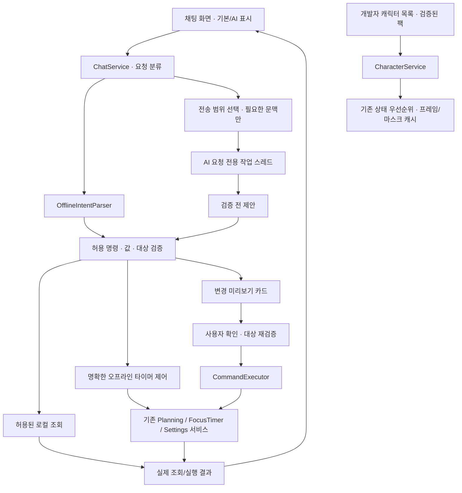

# PHASE 5·6 설계 — 채팅·제공 캐릭터·선택형 AI

작성일: 2026-11-03. 기준 실행 버전: 0.4.1 / DB 스키마 4.

**초기 설계와 후속 상태를 함께 기록합니다.** 2026-11-03 후속 요청으로 0.5.0에 **5A 오프라인 명령·확인·대화 보관/삭제**를 구현하고 스키마 5로 이전했습니다. [사용법](CHAT_GUIDE.md)과 [검증](TEST_REPORT.md)을 참고하세요. 5B 캐릭터 선택은 0.5.2, 6A 키 보관은 0.6.0, 6B 선택형 텍스트 대화는 0.6.1, 제한된 6C 작업 제안/확인은 0.6.2에 구현했습니다. 원본 명세의 '개인 이미지 가져오기'는 이후 사용자가 정한 **개발자 제공 3종 선택·업데이트로 추가** 방식으로 대체합니다.

## 1. 사용자가 보게 될 결과

| 단계 | 화면과 동작 | 완료 기준 |
|---|---|---|
| 5A | 관리창의 채팅 메뉴, 오프라인 표시, 지원 명령 예시·로컬 대화 기록 | 키·인터넷 없이 조회와 타이머 제어, 변경 전 확인 |
| 5B | 치이카와·하치와레·우사기 첫 선택과 설정에서 변경 | 준비·검증된 실제 이미지로 선택/상태 전환·재실행 복원 |
| 5C | 대화 삭제·보관 설정, 오류·접근성·사용성 정리 | 기존 데이터 보존, 실패 시 입력 유지, 빈 버튼 없음 |
| 6A | 선택형 API 키 설정·연결 테스트·키 삭제 | 키 마스킹·Credential Manager 보관, 키 없이 기존 기능 유지 |
| 6B | 같은 채팅창의 AI 모드, 전송 범위 안내, 중지·재시도 | GUI를 멈추지 않는 요청과 오류 시 로컬 기능 유지 |
| 6C | AI가 제안하는 제한된 일정/할 일 명령과 확인 카드 | 임의 SQL/파일/셸 실행 없음, 실제 저장 결과만 완료 표시 |

실행 버전 0.5.2는 5A·5B와 타이머 사용성 개선 범위입니다. 6단계 버전과 일정은 아직 확정하지 않았습니다. 7단계 외부 일정 교환과 8단계 정식 배포 검증은 별도입니다.

## 2. 공통 구조



새 모듈 이름은 설계상 제안입니다. 지금 빈 클래스나 작동하지 않는 메뉴를 추가하지 않습니다. 기존 UI와 채팅은 동일한 서비스를 호출합니다. AI 작업 스레드는 HTTP와 응답 파싱만 하고, GUI 스레드의 SQLite 연결이나 위젯을 직접 사용하지 않습니다.

## 3. PHASE 5 — 오프라인 명령

### 3.1 명령 범위

| 예시 | 처리 |
|---|---|
| 안녕 / 도움말 | 짧은 규칙 응답·실제 지원 예시 |
| 오늘 할 일 보여줘 / 내일 일정 보여줘 / 2026-11-10 일정 보여줘 | 해당 서울 날짜의 실제 발생 항목 조회 |
| 오늘 얼마나 공부했어? / 이번 주 공부 시간 | 기존 통계 서비스 조회. 휴식·일시정지 제외 |
| 25분 집중 시작 / 1시간 집중 시작 | 1~1,440분 검증 후 타이머 시작 |
| 타이머 일시정지 / 재개 / 중지 | 현재 서비스 상태에 맞게 처리. 중지는 미완료 기록 의미 안내 |
| 캘린더 열어줘 / 설정 열어줘 / 내 상태 알려줘 | 기존 관리창 이동·실제 현재 상태 조회 |
| 내일 오후 3시에 알고리즘 공부 추가해줘 | 날짜·시간·제목을 해석해 미리보기. 할 일/일정이 모호하면 먼저 선택 |
| 자료구조 복습 완료해줘 | 일치하는 항목을 제시한 뒤 완료 확인. 동명 항목이면 날짜별 선택 |
| 이 할 일을 내일로 옮겨줘 / 삭제해줘 | 대상을 확정하고 변경/삭제 확인. 반복은 이번만/이후/전체 범위 선택 |

'5시'처럼 오전/오후가 없거나, '정지'처럼 일시정지/중지가 모호하면 실행하지 않습니다. 요일·이미 지난 시각도 확인 카드에서 절대 날짜로 표시합니다. 여러 문장을 한 번에 변경하는 일괄 실행은 초기 범위에서 제외합니다. 이해하지 못하면 입력을 유지하고 지원 예시를 보여줍니다. 기본 모드를 자유로운 AI 대화로 홍보하지 않습니다.

### 3.2 확인과 실행

- 조회와 오프라인으로 명확하게 해석한 타이머 시작/일시정지/재개는 즉시 처리합니다. AI가 생성한 제어 제안은 확인 카드를 거칩니다. 타이머 중지/초기화, 데이터 추가·수정·완료·삭제는 변경 내용을 먼저 보여줍니다.
- 진행 중 타이머를 다른 명령이 임의로 중단하거나 덮어쓰지 않습니다.
- 카드에는 절대 날짜/시간대, 할 일 또는 일정 구분, 제목, 분류, 반복 범위, 변경 전·후를 표시합니다.
- 카드의 '확인'은 UI가 발급한 요청 ID에만 연결합니다. AI가 '사용자가 승인했다'고 쓴 문장은 승인이 아닙니다.
- 확인 직전 대상 ID·발생 키·현재 버전을 다시 확인합니다. 다른 화면에서 바뀌거나 삭제된 대상은 재확인합니다. 만료된 카드와 앱 재시작 전 카드는 실행하지 않습니다.
- 같은 확인을 두 번 눌러도 한 번만 적용되도록 operation_id와 실행 상태를 기록합니다. 실제 변경과 실행 기록은 같은 트랜잭션이어야 합니다. 기존 서비스의 내부 커밋과 중첩 충돌을 먼저 점검하고 공통 Unit of Work를 도입한 뒤 연결합니다. 단순히 바깥에서 SQLite with를 한 겹 더 씌우지 않습니다.
- 타이머 명령도 요청 ID를 체크포인트와 함께 처리해 재시작·중복 전송으로 두 세션을 만들지 않습니다.
- 성공 문장은 커밋 후 실행 결과로 작성합니다. 취소/실패/제안 단계에 '저장했어요'를 표시하지 않습니다.

### 3.3 대화와 데이터

`chat_sessions`, `chat_messages`, `command_operations`는 0.5.0 스키마 5에 구현했습니다. 사용자·앱 응답, 로컬/AI 모드, 생성 시각, 요청 ID·실행 상태를 분리합니다. API 키는 어떤 테이블에도 저장하지 않습니다. 보관 off·대화별/전체 삭제는 확인 후 실행하며, 대화 삭제가 일정이나 공부 기록을 함께 삭제하지 않습니다. 보관 off여도 필요한 명령 중복 방지 식별 정보는 본문 없이 별도로 유지합니다.

기존 DB는 backup API 백업 후 이전합니다. 0.5.0은 스키마 5, 대화 화자 정보를 추가한 0.5.1은 스키마 6입니다. 메시지는 기본 최근 50개부터 점진적으로 읽어 오래된 대화가 창을 멈추지 않게 합니다. 사용자/AI 문자열은 일반 텍스트로 표시하고 HTML·스크립트·임의 링크 실행을 하지 않습니다.

## 4. PHASE 5 — 개발자 제공 캐릭터

### 4.1 목록과 첫 선택

- 고정 ID: `chiikawa`, `hachiware`, `usagi`. 새 종류는 개발자가 앱 업데이트에 추가합니다. 사용자에게 이미지 업로드·폴더 탐색 메뉴를 제공하지 않습니다.
- 개발용 기본 모루는 유지합니다. 준비되지 않은 캐릭터를 모루 그림으로 위장해 선택 목록에 넣지 않습니다.
- 새 배포본의 첫 선택은 **세 캐릭터의 유효한 실제 idle 이미지가 모두 준비된 뒤** 제공해 인수합니다. 준비 전에는 3종 선택 완료로 보고하지 않습니다.
- 신규 설치는 첫 선택 후 `character_id`를 저장합니다. 기존 0.4.1 사용자는 모루와 기존 설정을 보존하고 설정에서 새 캐릭터를 선택할 수 있게 이전합니다.
- 캐릭터 ID와 사용자가 부르는 이름은 별도 값입니다. 캐릭터를 바꿔도 타이머·공부 기록·위치·전역 표시 설정을 초기화하지 않습니다.

### 4.2 원본에서 배포 팩까지

```text
개발자가 넣는 원본: assets/characters/<id>/<state>/...
    → 명시적으로 실행하는 준비 도구: 원본 보존 · PNG 변환/정렬 · manifest 생성 · 검증
    → 검증된 결과만: assets/character_packs/<id>/...
    → 개발자 목록의 고정 팩만 앱 빌드에 포함
    → 사용자는 목록에서 선택
```

현재 spec은 모루·아이콘과 고정 3종 팩의 각 5파일을 포함합니다. `assets` 전체를 포함하지 않으며 준비 폴더의 파일은 자동 공개·배포되지 않습니다. 별도 자동 변환 도구는 없고 개발자가 팩을 구성한 뒤 검증합니다.

### 4.3 팩 계약과 전환

- 기존 모루와 같은 `id/name/states` manifest와 상태별 frames/fps/loop 구조를 기본으로 사용합니다. 배포 목록에는 별도로 팩 버전·미리보기·사용 가능 여부를 둡니다.
- `idle`은 필수입니다. 한 프레임도 허용합니다. 파일 누락·빈 이미지·캔버스 불일치·PNG 손상·팩 밖 경로·지나치게 큰 프레임/총 메모리를 검증합니다.
- 구현 한도: 디코딩 예산 64 MiB, 총 64프레임·개별 PNG 1,024px 이내, 파일 8 MiB 이내. 아틀라스는 최대 4,096px/4,194,304픽셀입니다. 헤더·좌표·프레임별 지연을 검사하고 256px 런타임 프레임으로 정규화합니다.
- 없는 상태는 **같은 캐릭터의 idle**로 대체합니다. complete는 같은 팩의 happy가 있으면 재사용할 수 있습니다. worried가 없다고 sad를 앞당겨 재생하지 않습니다. 원치 않는 모루/다른 캐릭터로 섞어 표시하지 않습니다.
- 사용자가 팩을 바꾸면 새 자료를 먼저 검증합니다. 성공할 때만 프레임 타이머를 잠시 멈추고 클립·실루엣 마스크·크기 캐시를 원자적으로 교체한 뒤 현재 집중/휴식/수면 상태를 다시 적용합니다. 실패하면 이전 팩 유지.
- 타이머 진행과 반응 우선순위는 기존 서비스가 소유합니다. 캐릭터 교체가 집중 시간을 다시 시작하거나 완료/감정을 중복 발동하지 않습니다.
- 선택한 팩이 업데이트에서 없거나 손상되면 안내 후 모루로 복구하고 다른 사용자 데이터는 보존합니다.

사진의 실제 준비 순서는 [캐릭터 이미지 안내](../assets/characters/README.md)를 따릅니다.

## 5. PHASE 6 — 선택형 OpenAI 연결

### 5.1 설정과 키

기본은 계속 로컬 모드입니다. 설정에 '키 입력(마스킹) → 저장 → 연결 테스트 → AI 모드 켜기'를 제공합니다. 키를 저장했다고 자동으로 데이터를 보내지 않습니다. 테스트 버튼은 고정된 짧은 테스트 문장만 보내며 실제 네트워크 요청과 비용이 생길 수 있음을 버튼 주변에 알립니다. 모드 변경/키 삭제 시 진행 중 요청과 오래된 확인 카드를 무효화합니다.

프로젝트 규칙에 따라 개인 BYOK 키는 Windows Credential Manager에 사용자 단위로 저장합니다. 키 본문을 SQLite·JSON·로그·채팅·Git·EXE·Qt 상태 신호에 넣지 않습니다. 읽은 키는 요청 작업의 메모리에서만 사용합니다. 저장 실패 시 평문 파일로 우회하지 않습니다. 키 삭제는 보안 저장 항목만 제거하며 계획/공부 기록을 지우지 않습니다. 로컬 보안 저장이 같은 사용자 권한으로 실행되는 악성 프로그램까지 완전히 막는다고 안내하지 않습니다.

OpenAI는 API 키를 클라이언트 코드에 노출하지 말라고 안내합니다. 따라서 개발자의 공용 키를 앱에 내장하지 않습니다. 다수 사용자에게 개발자 비용으로 제공하는 AI 서비스는 별도 서버 인증/키 관리 설계가 필요합니다. 개인이 자기 키를 입력하는 방식도 로컬 키 노출 가능성을 설명합니다. [공식 인증 안내](https://developers.openai.com/api/reference/overview)

### 5.2 요청과 기능 호출

- Responses API와 공식 Python SDK를 후보로 사용합니다. 모델 ID·호환 옵션·SDK 버전은 구현 시 실제 계정과 공식 문서로 확정하며 이번 설계에서 가격·사용 가능 모델을 고정하지 않습니다.
- 함수 도구는 명시적 `strict: true`, 객체별 `additionalProperties: false`, 모든 필수 필드와 nullable 선택 필드를 정의합니다. 초기에는 `parallel_tool_calls: false`로 동시 명령을 줄입니다. 그래도 앱에서 이름·인수·범위·현재 상태를 다시 검증합니다. 스키마 준수는 사용자 승인이나 실행 성공을 뜻하지 않습니다. [공식 함수 호출 안내](https://developers.openai.com/api/docs/guides/function-calling)
- 허용 목록은 5단계의 로컬 명령과 같은 조회·제안뿐입니다. 모델에 DB 연결·임의 SQL·파일 읽기/삭제·셸·외부 플러그인 실행 기능을 주지 않습니다.
- 변경 도구는 즉시 실행하는 `create_event` 대신 '변경 제안 만들기'를 반환하고, 실제 저장은 동일한 확인 카드와 CommandExecutor로 수행합니다.
- 모델의 단순 응답 문장에는 실행 증거 권한이 없습니다. 일정 조회/저장 여부와 앱 완료 표시는 실제 서비스 결과를 기준으로 별도 표시합니다.
- 일단 한 요청당 최대 4회 도구 왕복·한 번의 변경 제안으로 제한합니다. 제한을 넘거나 불명확하면 중단하고 사용자에게 범위를 좁혀 달라고 안내합니다. 이는 제품 설계 값입니다.

### 5.3 보내는 데이터와 보관

| 정보 | 기본 동작 |
|---|---|
| 현재 입력한 AI 메시지 | 온라인 모드 표시와 전송 안내 후 해당 요청에 전송 |
| 이전 대화 | 기본 자동 첨부 안 함. 선택 시 최근 최대 6턴/6,000자부터 제한 |
| 일정·할 일·공부 기록 | 기본 전송 안 함. 필요한 범위를 미리 보여주고 허용한 필드만 전송 |
| 캐릭터 원본 이미지·다른 파일·DB 전체 | 전송 안 함 |
| API 키 | 인증 헤더로만 사용. 대화 문맥에는 넣지 않음 |

조회 자체는 로컬에서 가능합니다. AI가 로컬 조회 결과를 필요로 하면 날짜·항목 범위와 전송 내용을 보여주고 사용자가 허용한 뒤 모델에 반환합니다. 허용하지 않으면 로컬 결과만 표시합니다. 일정 제목 등 조회 결과의 텍스트는 명령으로 해석하지 않습니다.

요청은 `store: false`를 기본으로 하며 서버 대화 보관 기능과 장기 대화 ID를 기본 사용하지 않습니다. 이 옵션을 'OpenAI에 어떤 정보도 남지 않음'으로 설명하지 않습니다. 공식 문서는 응답 상태 보관과 abuse monitoring 등 보관 유형을 구분하므로 전송 안내에서 해당 정책을 연결합니다. [공식 데이터 제어 문서](https://developers.openai.com/api/docs/guides/your-data)

키로 보이는 값을 채팅에 붙여넣으면 저장/전송 전에 중단하고 전용 키 입력란을 안내합니다. 탐지 규칙을 완벽한 보안 보장으로 홍보하지 않습니다. HTTP 디버그 본문·인증 헤더·원문 오류를 로그나 오류창에 그대로 남기지 않습니다.

### 5.4 응답 지연과 실패

HTTP는 작업 스레드에서 실행하고 GUI·타이머는 계속 동작합니다. 초기 제안은 연결 10초/응답 60초 제한, 자동 재시도 기본 off입니다. 취소는 해당 요청 ID의 후속 표시·명령을 무효화하고 연결 중단을 시도합니다. 이미 전송된 요청의 처리·요금까지 취소된다고 보장하지 않습니다.

키 오류·모델 미지원·한도/속도 제한·오프라인·시간 초과를 구분해 한국어로 안내합니다. API가 실패해도 계획/달력/타이머는 계속 사용할 수 있고, 로컬 명령으로 돌아갈 수 있습니다. 실패한 AI 입력을 알림 없이 자동 재전송하지 않습니다. 명시적 재시도도 오래된 변경 카드를 재사용하지 않습니다.

사용 토큰은 실제 응답 usage로 표시하고, 없는 경우 '확인 불가'로 표시합니다. 원화 확정 비용이나 계정 전체 청구 상한을 앱이 보장하지 않습니다. SDK/계정/요금 조건은 구현과 배포 전에 다시 확인합니다.

## 6. 구현 순서와 인수 검사

| 체크포인트 | 반드시 통과할 검사 |
|---|---|
| 5A 명령/대화 | 네트워크 없이 실행, 모호한 문장 비실행, 동명 항목 선택, 진행 타이머 보호, 변경 확인/취소, 중복 클릭 1회 적용, 저장 실패 입력 보존 |
| 5B 팩 준비/선택 | 3종 실제 idle, RGBA/크기/순서/폴백, 단일 프레임, 누락·경로 이탈·메모리 초과 거부, 상태/위치/타이머 유지, 재시작 복원 |
| 5C 데이터/UX | 스키마 4 원본 백업/이전, 대화 삭제와 계획 분리, 기록 off, 긴 대화 점진 로딩, 키 형태 본문 저장 거부, Qt/네이티브/실제 입력 구분 |
| 6A 키 | 전용 Windows 보안 저장, 실패 시 평문 우회 없음, 마스킹, 저장/조회/삭제, 가짜 canary 키가 JSON/DB/로그/화면 오류/번들에 없음을 확인 |
| 6B 온라인 | 실제 GUI 비차단, 취소·화면 닫기·모드 전환 뒤 지연 결과 무시, 동의 없는 DB 내용 미전송, 가짜 응답으로 401/403/429/네트워크 오류/시간 초과 검사 |
| 6C 명령 | 미허용 도구/잘못된 날짜/삭제된 대상/반복 범위/프롬프트 삽입 거부, 확인 전 변경 없음, 실패를 성공으로 표현하지 않음, 5단계와 같은 중복 방지 |
| 통합 | 현재 148개 회귀 기반 유지, 임시 DB로 스키마/상태/종료 검사, 직접 허용한 별도 테스트에서만 실제 키/API 사용, EXE·Credential Manager 실기기 검증 |

5A는 0.5.0에 구현·자동/Qt 자체 검증했고 5B는 0.5.2에 실제 3종 팩·첫 선택·그림/말투 연결을 구현했습니다. 5C의 실제 입력·접근성 인수는 남아 있습니다. 0.6.0에는 후속 요청으로 6A 키 보관을 구현하고 가짜 값으로 검증했습니다. 0.6.1의 6B는 대체 HTTP/Qt 검사까지 수행했으며 실제 인증/청구와 6C는 미검증입니다.

## 0.5.1 구현 반영

대화 캐릭터 선택과 말투 프로필은 [캐릭터 대화 명세](CHARACTER_DIALOGUE.md)에 따라 구현했다. 선택은 `chat_character_id`, 메시지 화자는 스키마 6의 `character_id/profile_version`으로 보관한다. 0.5.2에서는 5B 실제 이미지 팩의 고정 ID와 대화 선택을 연결했다. 6B는 동일한 말투 규칙·정보 보존 지침과 우사기 외곽 형식을 AI 응답에 적용한다.

## 0.6.0 구현 반영 — 6A

설정에 마스킹 입력·Windows 자격 증명 저장/교체/삭제·저장 여부 조회를 연결했다. 시작 시 키를 읽지 않고 저장된 본문은 UI에 불러오지 않는다. 처리/닫기 때 입력과 undo를 비우며 키 변경 성공 때 이전 확인 카드를 무효화한다. 별도 개발 데이터 폴더의 키 항목을 격리했다. DB 스키마는 6을 유지한다. [6A 사용법](API_KEY_GUIDE.md)·[검토 기록](PHASE_6A_REPORT.md)을 따른다.

0.6.0 당시 연결 테스트·온라인 모드·모델 선택·실제 API 요청·AI 명령은 미구현이었다. 6A 저장 성공은 API 인증 성공을 의미하지 않는다.

## 0.6.1 구현 반영 — 6B

연결 테스트·모델 선택·선택형 AI 텍스트·취소·토큰 안내를 구현했다. 실행 시 오프라인이며 테스트 성공 후 직접 켠다. 공식 SDK의 Responses API를 사용하고 `store=false`, 도구 없음, 자동 재시도 없음, 고정 HTTPS 경로, TLS 검증과 환경 프록시/리다이렉트 차단을 적용했다. SDK는 최초 요청 시 작업 스레드에서 불러와 오프라인 시작 의존성을 줄인다.

현재 문장과 캐릭터 지침만 보낸다. 위 전송 표의 선택형 이전 대화/DB 조회 동의 기능은 이번 범위에 포함하지 않으며 자동 첨부도 없다. GUI 저장 승인 전에 작업 스레드에서 키/입력을 검사하고, 저장 실패 시 HTTP를 시작하지 않는다. 응답의 명령 문장은 실행하지 않는다. 취소·맥락 변경·종료 뒤 늦은 결과는 버리지만 이미 전송된 요청/요금 취소는 보장하지 않는다. 스키마 6을 유지한다.

[온라인 사용법](ONLINE_GUIDE.md)·[6B 검토](PHASE_6B_REPORT.md)를 따른다. 실제 사용자 키/인증/모델 권한/과금·실제 장치 인수와 6C 제한된 작업 제안/확인은 남아 있다.

## 0.6.2 구현 반영 — 제한된 6C

후속 요청에 따라 실행 중 별도 허용하는 함수 4종을 연결했다. 할 일/일정 추가, 날짜 이동/완료/완료 취소/삭제, 타이머 변경은 즉시 실행하지 않고 앱의 확인 카드를 만든다. 동명 대상·반복 범위는 기존 선택을 재사용하며 카드 ID·만료·현재 대상/타이머·중복·트랜잭션 롤백은 앱이 검증한다. AI의 인수로 ID·승인·반복 범위를 전달받지 않는다. 일반 제목/시간 편집·새 반복 생성·일괄 변경은 이번 범위 밖이다.

함수는 `strict=true`, 모든 필드 필수/nullable 선택, `additionalProperties=false`, `parallel_tool_calls=false`를 사용한다. SDK 응답 뒤에도 앱에서 이름·키·타입·날짜/시각·분/문자열 한도를 다시 검증한다. 한 응답의 함수는 최대 하나, HTTP 왕복도 한 번이며 모델 완료 주장은 버린다. [공식 함수 호출 문서](https://developers.openai.com/api/docs/guides/function-calling)를 확인했다.

기준 서울 날짜만 문맥에 추가한다. 기기 내 조회는 실제 앱 결과를 표시하며 결과/항목 목록을 AI로 반환하거나 추가 HTTP 요청하지 않는다. 위의 선택적 DB 결과 전송 동의·최근 대화 첨부 설계는 아직 제공하지 않는다. AI 카드 출처는 메모리에만 두고 재시작에 복원하지 않는다. 허용 끄기/맥락/페이지/닫기 때 카드와 지연 결과를 무효화한다. [작업 제안 안내](AI_ACTIONS_GUIDE.md)·[6C 검토](PHASE_6C_REPORT.md)를 따른다. 실제 계정/모델·장치/배포 인수는 남아 있다.
