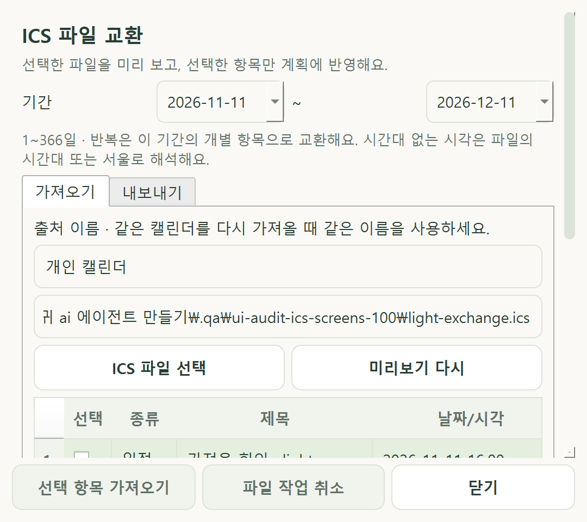
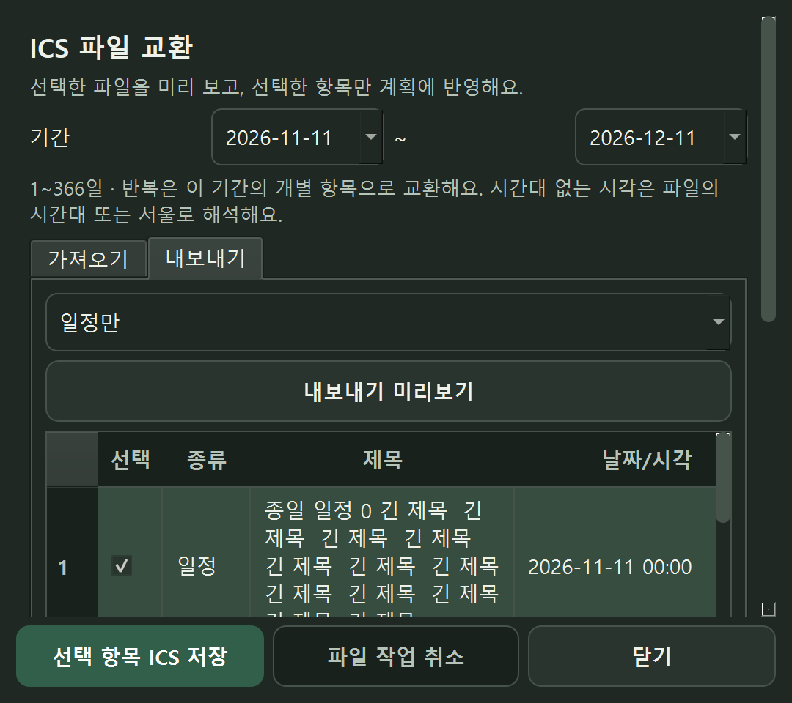

# PHASE 7A 검토 — 0.7.0

2026-11-11 후속 요청에 따라 로컬 ICS 미리보기·입출력·중복/충돌 처리를 구현했습니다. Planit 공식 연동은 7B의 조사 대상으로 남겼습니다. 사용자 DB/원본 사진/실제 키를 검사에 사용하지 않았습니다.

## 구현

- `calendar/ics_codec.py`: icalendar 7.3 기반 제한된 VEVENT/VTODO 스냅샷. UTF-8·8 MiB·구성 요소/결과 각 1,000개·1~366일, 줄/중첩/반복 탐색 한도를 적용합니다. 첨부/초대/URL/알람과 사용자 정의 VTIMEZONE은 라이브러리 해석 전에 제외합니다. 내장 IANA 시간대와 원본 시간대의 반복을 계산한 후 서울로 변환합니다.
- `services/calendar_transfer.py`: 읽기 전용 미리보기, 출처/UID/원래 발생일과 내용 해시, 원본 변경·앱 수정 충돌·삭제 tombstone·자체 내보내기 UID·시간 겹침 분류. 갱신은 직접 선택·별도 확인을 요구합니다. 5분 만료와 저장 직전 전체 계획 fingerprint 재검증, 선택 배치의 원자적 저장, 성공 후 화면 갱신 한 번을 보장합니다.
- 스키마 7: 앱 namespace, 출처, 외부 연결 테이블. 6→7 전 SQLite backup API 백업, 삭제된 로컬 대상의 연결은 식별 정보만 남깁니다. 기존 사용자 데이터 위치/내용은 초기화하지 않습니다.
- `ui/calendar_transfer.py`: 캘린더/설정에서 여는 실제 파일 교환 창. 기간·출처·개별 체크·현재/파일 상세·추가/갱신 최종 확인·제외 사유·취소. 파싱/파일 직렬화/쓰기는 작업 스레드에서 처리하며 DB/위젯을 작업 스레드에서 접근하지 않습니다. 닫기/조건 변경 후 지연 결과를 버립니다. 작은 창의 적용/저장 버튼은 하단에 고정했습니다.
- `calendar/file_io.py`: 명시적으로 선택한 `.ics` 파일, 경로/크기/링크/스트림/예약 이름 검사. 같은 폴더의 임시 파일을 flush/fsync한 후 승인한 대상의 지문을 다시 검사하고 교체합니다. 취소·실패 시 기존 파일을 유지하고 자신의 임시 파일만 정리합니다.

반복을 선택 기간의 독립 항목으로 교환하며 자동 구독·삭제·동기화는 제공하지 않습니다. RFC 전체를 지원한다는 의미가 아닙니다. 시작 시각 없는 마감 할 일은 00:00 시작과 정확한 마감을 기록하고 자체 보조 속성으로 앱 재입력 때 시작 없음으로 복원합니다. 지원하지 않는 반복/마감·시간대의 구체적인 경계와 외부 앱 표시 차이는 [사용법](ICS_GUIDE.md)에 기록했습니다. 표준은 [RFC 5545](https://www.rfc-editor.org/rfc/rfc5545.html), 구현 라이브러리는 [icalendar 공식 문서](https://icalendar.readthedocs.io/en/stable/reference/api/icalendar.cal.html)를 대조했습니다.

## 검증

Windows 11 build 26200 / Python 3.12.14 / PySide6 6.12.0 / pytest 9.2.0 / ruff 0.17.3 / PyInstaller 6.22.3 / icalendar 7.3.0.

| 검사 | 결과 |
|---|---|
| 신규 ICS | 84개 통과: 파싱/시간대/반복/예외·마감 타입·중복/자체 재입력/충돌·미리보기 무효화·배치 롤백/단일 갱신·파일 교체·UI 비차단/취소·이전 백업 |
| 전체 회귀 | 732개 통과, 독립 QA 폴더의 두 파일 묶음 431 + 301 |
| Windows Qt | ICS 84 + AI 제안 100 + 키보드/접근성 24 = 208개 통과 |
| 화면 | 61상태 × 4배율 = 244개, 자동 겹침/잘림/가로 넘침 0. 당시 실제 DPR 2/2.5/3/4, 시스템 설정 변경 없음 |
| 품질 | Ruff check/format, pip check, 문서 내부 링크·변경 파일 검사 통과 |
| 빌드/ZIP | 0.7.0 빌드·모듈/버전/고정 에셋·icalendar 메타데이터/라이선스·897개 파일과 SHA-256/ZIP 체크섬 확인 |

앞선 Windows 실행에서 키보드 초점 테스트 한 건이 실패했으나 동일 코드로 재실행한 208개에서는 재현되지 않았습니다. 실제 OS 초점 인수는 남깁니다. 화면 검사에서는 비동기 busy 해제와 Qt 레이아웃 완료 사이의 geometry를 읽은 경우가 있어 검사 도구가 대기 중인 레이아웃/스크롤 이벤트를 기다린 후 네 배율을 다시 실행했습니다. [최종 검증 기록](TEST_REPORT.md)에 증거와 해시를 정리했습니다.

아래 이미지는 작은 창의 QA 예시입니다. 긴 목록과 상세는 안쪽/바깥쪽 스크롤로 확인하며 적용/저장 버튼은 하단에 고정합니다.

검토 중 외국 시간대 반복을 서울 날짜로 잘못 재해석할 가능성을 찾아 원본 시간대에서 발생일을 계산하도록 보강했습니다. 종일 날짜는 유지하고 시각만 서울로 변환합니다. 역사적 서울 일광절약 중복 시각에서 naive 시각을 쓰는 할 일의 표현 손실을 거부하며 일정의 정확한 instant는 보존합니다. VTODO의 DTSTART/DUE 타입과 순서를 RFC와 대조하고 표현할 수 없는 기존 항목은 제외 사유를 보여줍니다.

일부 옛 스키마 시험이 현재 스키마 전체를 만든 뒤 버전 숫자만 낮춰 새 테이블이 중복되는 문제는 가짜 레거시 fixture에서 새 테이블을 제거하도록 수정했습니다. 실제 마이그레이션의 무결성 검사는 완화하지 않았습니다. 화면 점검에서 적용/저장 버튼이 바깥 스크롤 아래로 밀리던 문제를 발견해 하단에 고정했습니다.

## 미검증과 다음 단계

실제 외부 캘린더 제품의 파일·원래 UID 유지·VTODO 표시, OS 파일 선택창·권한/디스크 부족·실제 IME/스크린리더·혼합 DPI/Windows 10/장시간 인수는 [수동 목록](MANUAL_TESTS.md)에 남습니다. 이전 EXE가 Windows 앱 제어에 차단된 상태이므로 이번 EXE도 실행 미검증입니다. 빌드·정적 포함 파일·ZIP 무결성과 실행 성공은 구분하며 정책 변경이나 우회 실행을 하지 않습니다.

소스 실행은 트레이 종료 후 먼작귀 바로가기 또는 `run_windows.bat`, 기능 위치는 **캘린더/설정 → ICS 파일 교환**입니다. 다음 기능은 Planit KR의 공식 API/파일 교환 지원 근거 조사이며, 지원을 확인하기 전 계정 연결이나 비공식 접근을 만들지 않습니다.
