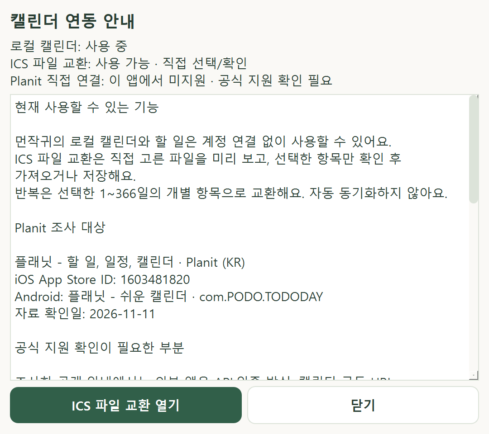

# Planit 공식 연동 조사와 사용 안내 — 0.7.1

**자료 확인일: 2026-11-11. 공개 자료 조사 결과이며 실시간 연결 상태가 아닙니다.**

현재 먼작귀는 로컬 캘린더와 [ICS 파일 교환](ICS_GUIDE.md)을 제공합니다. Planit 직접 연결·자동 동기화는 구현하지 않았습니다. 공개 자료에서 공식 연동 수단을 확인하지 못한 상태이며, Planit에 해당 기능이 없다고 단정하지 않습니다.

## 조사 대상과 공식 근거

원본 요구사항의 가정에 따라 아래 제품을 조사했습니다. 다른 이름이 같은 서비스와 구분할 수 있도록 ID를 앱 안내에도 표시합니다.

| 대상 | 공식 자료에서 확인한 식별 정보 |
|---|---|
| iOS | 플래닛 - 할 일, 일정, 캘린더, 개발자 Planit (KR), App Store ID `1603481820`. [App Store 개발자 등록 페이지](https://apps.apple.com/kr/app/%ED%94%8C%EB%9E%98%EB%8B%9B-%ED%95%A0-%EC%9D%BC-%EC%9D%BC%EC%A0%95-%EC%BA%98%EB%A6%B0%EB%8D%94/id1603481820) |
| Android | 플래닛 - 쉬운 캘린더, 개발자 Kim BeomJoon, 패키지 `com.PODO.TODODAY`. [Google Play 개발자 등록 페이지](https://play.google.com/store/apps/details?id=com.PODO.TODODAY&hl=ko) |
| 개발자 사이트 | 두 스토어가 개발자 웹사이트로 안내하는 [planit.day](https://www.planit.day/). 조사 환경의 텍스트 도구에서는 본문을 추출하지 못했고, 브라우저에서는 로딩 표시만 확인해 내부 안내를 검증하지 못함 |

스토어의 제품 설명·개발자 웹사이트 링크를 확인했습니다. 일반 이용자 리뷰와 다른 이름의 Planit 서비스, 제3자 블로그의 추측은 연동 근거로 사용하지 않았습니다. 공개 자료 열람만 수행했으며 로그인·계정 조회·일정 접근·개발자에게 문의 전송은 하지 않았습니다.

## 연동 판단

| 방식 | 이번 조사 결과와 앱 처리 |
|---|---|
| 외부 개발자용 공식 API/인증 | 검증 가능한 공개 명세·허용 인증/권한을 확인하지 못함. 직접 연결 구현 없음 |
| CalDAV/iCalendar 구독 URL | 발급·접근·갱신 방법을 확인하지 못함. URL 구독/자동 수집 구현 없음 |
| ICS 내보내기/가져오기 | Planit의 공식 절차와 지원 방향을 확인하지 못함. Planit과 파일 호환을 보장하지 않음 |
| 먼작귀 로컬 캘린더 | 계정 연결 없이 사용 가능 |
| 먼작귀 ICS 파일 교환 | 실제 구현·회귀 검사된 기능. 직접 파일 선택·미리보기·확인 후 처리. Planit 지원 여부와 별개 |

이는 **공식 지원 여부 미확인**이라는 판단입니다. 비공식 서버 추측·앱 역공학·인증정보 추출·계정 비밀번호 수집으로 대체하지 않습니다. 공개 웹사이트나 개인정보 문서가 존재한다는 사실만으로 일정 API 사용 권한을 추론하지 않습니다. 파일 교환은 상대 제품도 해당 방향의 ICS 입출력을 지원할 때만 가능합니다.

## 앱에서 확인하기

**설정 → 캘린더 파일·연동**에 로컬 사용·ICS 사용 가능·Planit 공식 지원 확인 필요를 구분해 표시합니다. **캘린더 연동 안내**는 대상 ID·확인 날짜·지원 범위·공식 자료 위치를 읽기 전용으로 제공합니다. 글은 선택/복사할 수 있고 작은 창에서는 스크롤합니다.

**ICS 파일 교환 열기**는 기존 파일 도구로 이동합니다. 안내를 열거나 이 버튼을 누르는 것만으로 파일을 선택/저장하지 않습니다. 파일 도구의 미리보기·최종 확인이 그대로 필요합니다. 닫기와 Escape는 안내만 닫으며, 안내를 열 때 네트워크·브라우저·자격 증명 저장소를 사용하지 않습니다.

## 공식 지원이 확인되면 다시 검토할 자료

- 사용 중인 Planit의 정확한 스토어 ID/플랫폼·버전과 공식 기능 설명.
- API라면 공개 문서·개발자 사용 허용·인증 방식/권한·요청 제한·오류/토큰 만료·삭제/충돌 정책.
- 파일이라면 내보내기/가져오기 각각의 지원 여부·메뉴 절차·UTF-8 ICS 예시·UID/반복 예외/시간대/종일/할 일 보존.
- 구독이라면 발급 방식·인증/URL의 비밀성·읽기 전용 여부·갱신/철회·양방향 쓰기와의 차이.

이번에 문의를 대신 보내지 않았습니다. 외부 문서/시험 파일이 확보되면 지원 방향과 데이터 보존을 QA 데이터로 검증한 후에만 연동 상태를 바꿉니다.

## 구현·검증과 남은 단계

주요 변경은 `ui/calendar_integration.py`의 읽기 전용 안내, `ui/management.py`의 실제 상태/파일 도구 이동, `tools/ui_smoke.py`의 실제 모달 이동과 DB 불변 검사입니다. 빈 제공자나 작동하지 않는 연결 버튼은 추가하지 않았습니다. DB 스키마 7·사용자 데이터 위치·네트워크 기본값·캐릭터 원본은 유지합니다.

전체 회귀 732개·Windows Qt 관련 117개가 통과했습니다. 63상태 × 4배율 252개에서 자동 배치 오류가 없었으며 실제 설정 → 안내 → ICS 창 이동/닫기에서 DB 불변을 확인했습니다. Ruff·의존성/문서 검사, 0.7.1 빌드와 ZIP 897개 파일/해시 검증을 완료했습니다. 상세는 [검증 기록](TEST_REPORT.md)을 따릅니다. 실제 Planit 계정/앱 버전/파일 호환, OS 키보드/IME·스크린리더·Windows 10과 EXE 실행은 확인하지 않았습니다. 공개 조사와 앱 안내를 완료했으며 실제 Planit 연동은 공식 근거가 확보될 때까지 미지원으로 남습니다.

아래는 별도 QA 데이터의 안내 화면입니다. 글은 스크롤하고 하단의 파일 도구/닫기 버튼을 사용할 수 있습니다.

다음 단계는 **8A 통합 안정성·복구 검증**입니다. 별도 QA 데이터로 재시작/집중 복구·알림 중복·작업 취소/종료·반복 실행 자원 사용을 확인하고, 실제 장치/배포 인수와 구분합니다.
